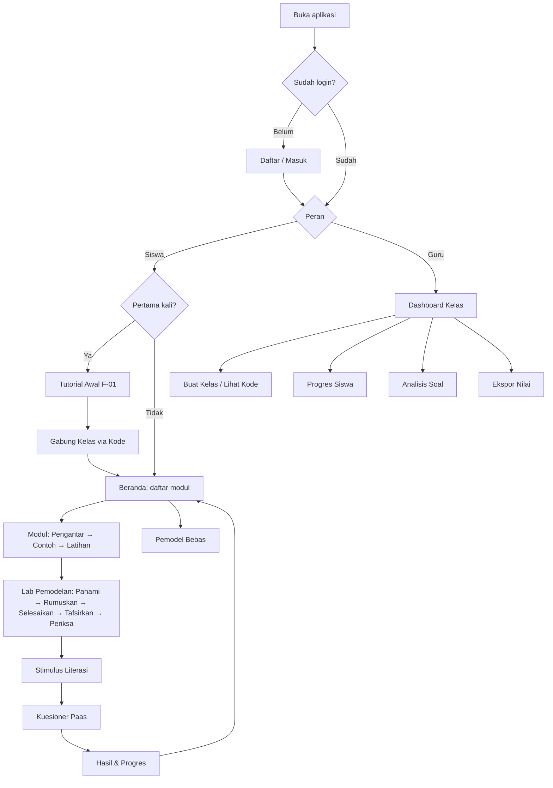

# 02 — Product Requirements Document (PRD)

| Atribut | Keterangan |
|---------|------------|
| Produk | KartesiusKu |
| Versi | 1.1 |
| Tanggal | 10 November 2026 |
| Penyusun | Inayatul Sholihah |
| Status | Draf untuk ditinjau |

## Daftar Isi
1. [Ringkasan](#1-ringkasan)
2. [Latar Belakang & Masalah](#2-latar-belakang--masalah)
3. [Tujuan & Metrik Keberhasilan](#3-tujuan--metrik-keberhasilan)
4. [Ruang Lingkup](#4-ruang-lingkup)
5. [Pengguna & Peran](#5-pengguna--peran)
6. [Daftar Fitur](#6-daftar-fitur)
7. [Kebutuhan Fungsional](#7-kebutuhan-fungsional)
8. [Kebutuhan Non-Fungsional](#8-kebutuhan-non-fungsional)
9. [Alur Pengguna Utama](#9-alur-pengguna-utama)
10. [Matriks Ketertelusuran](#10-matriks-ketertelusuran)
11. [Asumsi & Ketergantungan](#11-asumsi--ketergantungan)
12. [Risiko & Mitigasi](#12-risiko--mitigasi)
13. [Pertanyaan Terbuka](#13-pertanyaan-terbuka)
14. [Riwayat Revisi](#14-riwayat-revisi)

---

## 1. Ringkasan

KartesiusKu adalah aplikasi pembelajaran interaktif materi Koordinat Kartesius untuk siswa SMP kelas VIII yang berjalan di web dan Android. Aplikasi menekankan **manipulasi langsung pada bidang Kartesius**, **soal cerita yang terstruktur**, dan **antarmuka sederhana** untuk menurunkan beban kognitif ekstrinsik. Aplikasi juga **menumbuhkembangkan literasi matematika**: siswa dibimbing **memodelkan soal cerita ke dalam model matematika**, dan **mesin model** aplikasi menyelesaikan model tersebut langkah demi langkah (lihat [13-literasi-dan-pemodelan.md](13-literasi-dan-pemodelan.md)). Guru dapat membuat kelas serta memantau progres dan profil literasi siswa melalui dashboard.

## 2. Latar Belakang & Masalah

Wawancara siswa ([01-analisis-kebutuhan.md](01-analisis-kebutuhan.md)) menunjukkan:
- **W-1:** Siswa bingung menggambar garis yang melewati titik.
- **W-2:** Siswa kesulitan menentukan titik bila koordinatnya belum diberikan secara langsung.
- **W-3:** Siswa paling bingung dengan soal cerita panjang.
- **W-4:** Siswa belum pernah memakai aplikasi belajar; pembelajaran masih berbasis papan tulis.

Selain itu, pengembang menetapkan tujuan **menumbuhkembangkan literasi matematika**. Kesulitan pada soal cerita (W-3) menunjukkan lemahnya proses *merumuskan* situasi nyata menjadi model matematika, yang merupakan inti literasi matematika (PISA, AKM Numerasi).

**Pernyataan masalah:** Siswa kelas VIII membutuhkan media belajar Koordinat Kartesius yang memvisualisasikan titik dan garis secara interaktif, menyajikan soal tanpa membebani memori kerja, dan melatih mereka memodelkan serta menyelesaikan masalah kontekstual. Guru membutuhkan cara memantau pemahaman dan perkembangan literasi siswa.

## 3. Tujuan & Metrik Keberhasilan

| ID | Tujuan | Metrik | Target |
|----|--------|--------|--------|
| G-1 | Meningkatkan pemahaman konsep | Selisih skor pretest–posttest (N-gain) | N-gain ≥ 0,3 (kategori sedang) |
| G-2 | Menurunkan beban kognitif yang dirasakan | Rata-rata skala Paas (1–9) pada soal cerita | Lebih rendah dari pembelajaran konvensional / ≤ 5 |
| G-3 | Aplikasi mudah digunakan | System Usability Scale (SUS) | Skor ≥ 70 |
| G-4 | Media layak digunakan | Validasi ahli materi & ahli media | Kategori "layak"/"sangat layak" (≥ 75%) |
| G-5 | Siswa menyelesaikan materi | Tingkat penyelesaian modul | ≥ 80% siswa menyelesaikan semua modul |
| G-6 | Guru terbantu | Kuesioner kepraktisan guru | ≥ 75% |
| G-7 | Menumbuhkembangkan literasi matematika | N-gain tes literasi (awal–akhir) | N-gain ≥ 0,3 |
| G-8 | Meningkatkan kemampuan pemodelan | Rata-rata skor langkah ② Rumuskan pada Lab Pemodelan, sesi awal vs akhir | Naik ≥ 20 poin persentase |

## 4. Ruang Lingkup

### 4.1 Termasuk (In Scope) — MVP
- Materi Koordinat Kartesius kelas VIII (lihat [04-desain-pembelajaran.md](04-desain-pembelajaran.md)).
- Bidang Kartesius interaktif (plot titik, geser titik, garis melalui titik).
- Modul materi tersegmentasi dengan contoh dan latihan.
- Soal cerita terstruktur.
- **Lab Pemodelan** 5 langkah dan **mesin model** untuk 8 templat model Kartesius (MP-1 s.d. MP-8).
- **Pemodel Bebas** berbasis formulir templat untuk soal cerita dari luar aplikasi.
- **Stimulus literasi** bergaya AKM dan **profil literasi** siswa.
- Login siswa & guru, kelas dengan kode gabung.
- Dashboard guru (progres & hasil).
- Kuesioner beban kognitif dan SUS di dalam aplikasi.
- Web (PWA) dan Android (APK).

### 4.2 Tidak Termasuk (Out of Scope) — versi 1.0
- Materi selain Koordinat Kartesius.
- Persamaan garis lurus y = mx + c, gradien, dan jarak Euclid/Pythagoras (hanya garis sejajar/tegak lurus sumbu).
- Pembacaan teks soal cerita bebas secara otomatis memakai AI/NLP. Pemodelan selalu terpandu dan berbasis templat.
- Aplikasi iOS.
- Fitur chat/forum, gamifikasi kompleks (leaderboard antarsekolah).
- Pembuatan soal oleh guru melalui UI (versi 1.0: soal dikelola admin via file seed/panel admin sederhana).
- Pembayaran/langganan.

## 5. Pengguna & Peran

| Peran | Deskripsi | Hak Akses Utama |
|-------|-----------|-----------------|
| Siswa | Pengguna utama | Belajar materi, mengerjakan latihan, melihat progres sendiri, gabung kelas |
| Guru | Pengajar | Membuat/mengelola kelas, melihat progres & jawaban siswa di kelasnya, ekspor nilai |
| Admin | Pengembang/peneliti | Kelola akun guru, materi, soal; unduh data penelitian (anonim) |

## 6. Daftar Fitur

Prioritas MoSCoW: **M** = Must, **S** = Should, **C** = Could, **W** = Won't (versi ini).

| ID | Fitur | Deskripsi Singkat | Sumber | Prioritas |
|----|-------|-------------------|--------|-----------|
| F-01 | Tutorial Awal (Onboarding) | Tur interaktif 4–5 langkah cara memakai aplikasi & kanvas | W-4 | M |
| F-02 | Bidang Kartesius Interaktif | Kanvas SVG: grid, sumbu berwarna, ketuk untuk plot, geser titik, label koordinat real-time, snap ke bilangan bulat | W-1, W-2 | M |
| F-03 | Eksplorasi Titik | Mode bebas: siswa memindah titik dan melihat koordinat, kuadran, jarak ke sumbu | W-2 | M |
| F-04 | Titik Relatif terhadap Titik Acuan | Menentukan titik berdasarkan perintah "3 satuan ke kanan, 2 ke atas dari titik A"; panah langkah ditampilkan | W-2 | M |
| F-05 | Visualisasi Garis | Garis tergambar melalui dua titik; mode garis sejajar/tegak lurus sumbu X/Y; animasi langkah | W-1 | M |
| F-06 | Modul Materi Tersegmentasi | Materi per langkah kecil: penjelasan singkat → contoh lengkap → contoh dipudarkan → latihan | Semua | M |
| F-07 | Latihan Interaktif | Tipe soal: plot titik, baca titik, gambar garis, pilihan ganda, isian | W-1, W-2 | M |
| F-08 | Soal Cerita Terstruktur | Teks pendek + highlight angka, panel Diketahui/Ditanya/Langkah, ilustrasi di dekat teks | W-3 | M |
| F-09 | Petunjuk Bertahap & Umpan Balik | Hint 3 level; umpan balik spesifik per kesalahan (mis. x dan y tertukar) | W-1–W-3 | M |
| F-10 | Autentikasi | Daftar/masuk siswa (username + kata sandi), guru (email + kata sandi) | — | M |
| F-11 | Manajemen Kelas | Guru membuat kelas → kode 6 karakter; siswa gabung via kode | — | M |
| F-12 | Progres Siswa | Status modul, skor, bintang per modul | — | M |
| F-13 | Dashboard Guru | Ringkasan kelas, progres per siswa, analisis per soal (persentase benar, kesalahan umum) | — | M |
| F-14 | Kuesioner Beban Kognitif | Skala Paas 1–9 setelah modul/soal cerita; pretest-posttest | Penelitian | S |
| F-15 | Kuesioner SUS | 10 butir SUS setelah seluruh modul | Penelitian | S |
| F-16 | Ekspor Nilai | Unduh CSV/XLSX nilai kelas | — | S |
| F-17 | Mode Offline Ringan | Materi & latihan tersimpan cache; jawaban disinkronkan saat online | Persona (kuota terbatas) | S |
| F-18 | Bantuan Kontekstual | Tombol "?" di setiap layar berisi petunjuk singkat | W-4 | S |
| F-19 | Narasi Audio | Audio pembacaan soal cerita | W-3 | C |
| F-20 | Lencana Pencapaian | Lencana sederhana per modul selesai | — | C |
| F-21 | Penyusun Soal oleh Guru | UI guru membuat soal sendiri | — | W |
| F-22 | Lab Pemodelan Terpandu | Soal cerita dikerjakan lewat 5 langkah (Pahami → Rumuskan → Selesaikan → Tafsirkan → Periksa), pemeriksaan per langkah, *fading* 3 level | W-3, KB-10, KB-11 | M |
| F-23 | Pemodel Bebas | Pilih templat model, isi data cerita lewat formulir, lalu aplikasi menampilkan model, gambar, dan penyelesaian langkah demi langkah | KB-11 | S |
| F-24 | Stimulus Literasi | Satu stimulus (denah/peta/tabel) dengan 3–5 butir bertingkat bergaya AKM | KB-10 | M |
| F-25 | Profil Literasi | Skor per proses (Merumuskan, Menerapkan, Menafsirkan) untuk siswa & guru | KB-10 | S |
| F-26 | Kartu Model | Referensi ringkas MP-1 s.d. MP-8: kapan dipakai, notasi, contoh | KB-11, W-3 | M |
| F-27 | Mesin Model | Fungsi deterministik FE & BE: menyelesaikan model, membuat langkah penyelesaian, memeriksa langkah siswa | KB-11 | M |

## 7. Kebutuhan Fungsional

### 7.1 Autentikasi & Akun
- **FR-01** Siswa dapat mendaftar dengan nama tampilan, username unik, dan kata sandi (min. 6 karakter).
- **FR-02** Guru dapat mendaftar dengan nama, email, dan kata sandi (min. 8 karakter); akun guru aktif setelah diverifikasi admin (opsional untuk uji coba).
- **FR-03** Pengguna dapat masuk dan keluar; sesi bertahan hingga 7 hari (refresh token).
- **FR-04** Guru dapat mereset kata sandi siswa di kelasnya (siswa tidak memiliki email).

### 7.2 Kelas
- **FR-05** Guru dapat membuat, mengubah nama, mengarsipkan kelas.
- **FR-06** Sistem menghasilkan kode kelas 6 karakter unik (huruf kapital + angka, tanpa O/0/I/1).
- **FR-07** Siswa dapat bergabung ke kelas dengan kode; satu siswa dapat berada di satu kelas aktif.
- **FR-08** Guru dapat mengeluarkan siswa dari kelas.

### 7.3 Pembelajaran
- **FR-09** Sistem menampilkan daftar modul berurutan; modul berikutnya terbuka setelah modul sebelumnya selesai (dapat dinonaktifkan guru).
- **FR-10** Setiap modul terdiri dari segmen: Pengantar → Contoh → Contoh Dipudarkan → Latihan → Refleksi.
- **FR-11** Kanvas mendukung ketuk/klik untuk menaruh titik, seret untuk memindah, dan menampilkan koordinat di samping titik.
- **FR-12** Kanvas mendukung rentang −10 s.d. 10 (default) dan dapat diatur per soal.
- **FR-13** Garis otomatis tergambar setelah dua titik ditempatkan pada mode garis.

### 7.4 Latihan & Penilaian
- **FR-14** Sistem menilai jawaban di backend dan mengembalikan status benar/salah, umpan balik spesifik, dan skor.
- **FR-15** Siswa dapat meminta hint hingga 3 level; penggunaan hint dicatat dan mengurangi skor maksimal soal (100 → 90 → 75 → 60).
- **FR-16** Siswa dapat mencoba ulang soal; percobaan tercatat.
- **FR-17** Soal cerita menampilkan panel Diketahui/Ditanya yang dapat dibuka siswa; pada level awal panel diisi otomatis, pada level lanjut siswa mengisinya sendiri (*fading*).

### 7.5 Progres & Laporan
- **FR-18** Siswa melihat progres per modul (persentase, skor, bintang 0–3).
- **FR-19** Guru melihat tabel progres seluruh siswa di kelas.
- **FR-20** Guru melihat analisis per soal: % benar, rata-rata percobaan, rata-rata hint, kesalahan umum.
- **FR-21** Guru dapat mengekspor nilai kelas ke CSV.

### 7.6 Penelitian
- **FR-22** Sistem menampilkan kuesioner skala Paas setelah soal cerita/modul (dapat diaktifkan per kelas).
- **FR-23** Sistem menyediakan pretest dan posttest dengan soal setara.
- **FR-24** Admin dapat mengunduh data penelitian dalam format anonim (ID acak, tanpa nama).

### 7.7 Literasi & Pemodelan
- **FR-25** Lab Pemodelan menampilkan stepper 5 langkah. Hanya satu langkah aktif pada satu waktu; langkah yang benar dikunci.
- **FR-26** Pada langkah ① siswa dapat mengetuk token teks cerita dan memasukkannya ke kotak Diketahui/Ditanya. Sistem memeriksa kelengkapan informasi penting.
- **FR-27** Pada langkah ② siswa memilih jenis model (MP-1 s.d. MP-8) dan mengisi parameternya. Sistem menampilkan notasi model dan memeriksa kesetaraannya dengan kunci (urutan perpindahan boleh berbeda).
- **FR-28** Mesin model menyelesaikan model dan menghasilkan langkah penyelesaian berbahasa Indonesia beserta animasi kanvas. Tombol "Jalankan Model" tersedia setelah siswa mencoba (level 1–2) atau sebagai hint (level 3).
- **FR-29** Pada langkah ④ dan ⑤ siswa memilih/menyusun kalimat tafsiran dan alasan kewajaran. Jawaban tanpa satuan nyata atau arah dideteksi sebagai MK-12.
- **FR-30** Skor dihitung per langkah dengan bobot 15/30/25/15/15 dan dipetakan ke proses literasi.
- **FR-31** Pemodel Bebas menerima data melalui formulir templat, memvalidasinya, dan menampilkan model, gambar kanvas, langkah penyelesaian, serta kalimat jawaban. Hasil tidak dinilai dan tidak disimpan kecuali siswa menekan "Simpan".
- **FR-32** Stimulus literasi menampilkan data stimulus yang dapat disematkan (*pin*) selama siswa menjawab butir-butirnya.
- **FR-33** Sistem menghitung profil literasi per siswa dan per kelas, serta tren mingguan.
- **FR-34** Sistem menyediakan tes literasi awal dan akhir (paralel) sebagai bagian dari pretest/posttest.

## 8. Kebutuhan Non-Fungsional

| ID | Kategori | Kebutuhan |
|----|----------|-----------|
| NFR-01 | Kompatibilitas | Android 8.0 (API 26)+; Chrome, Edge, Firefox, Safari 2 versi terakhir |
| NFR-02 | Responsif | Tampilan optimal pada lebar 360–1440 px; orientasi potret di HP |
| NFR-03 | Kinerja | First load ≤ 3 detik di 4G; interaksi kanvas ≥ 50 fps di HP kelas menengah; ukuran APK ≤ 15 MB |
| NFR-04 | Kinerja API | p95 waktu respons ≤ 500 ms untuk 100 pengguna serentak |
| NFR-05 | Ketersediaan | Uptime ≥ 99% selama periode uji coba |
| NFR-06 | Keamanan | HTTPS, hash Argon2, JWT, rate limit login, otorisasi berbasis peran & kepemilikan kelas |
| NFR-07 | Privasi | Data minimal siswa, tidak ada iklan/pelacak pihak ketiga, ekspor penelitian teranonimkan |
| NFR-08 | Aksesibilitas | Kontras WCAG AA, target sentuh ≥ 48 dp, tidak hanya mengandalkan warna (gunakan bentuk/label) |
| NFR-09 | Kebahasaan | Bahasa Indonesia baku-santai, kalimat soal ≤ 15 kata |
| NFR-10 | Pemeliharaan | Cakupan tes logika penilaian ≥ 90%; kode lulus lint & type-check |
| NFR-11 | Offline | Materi yang pernah dibuka tetap dapat diakses tanpa internet |
| NFR-12 | Kebenaran mesin model | 100% fixture bersama lulus di FE (TS) dan BE (Python); hasil identik |
| NFR-13 | Kinerja mesin model | `solveModel` ≤ 50 ms di HP kelas bawah; dapat berjalan offline |

## 9. Alur Pengguna Utama

## 10. Matriks Ketertelusuran

| Temuan | Fitur | User Story | Pengujian |
|--------|-------|------------|-----------|
| W-1 | F-02, F-05, F-07, F-09 | US-S05, US-S06 | TC-CANVAS-*, TC-LINE-*, Paas modul 4 |
| W-2 | F-02, F-03, F-04, F-07, F-09 | US-S03, US-S04 | TC-POINT-*, TC-REL-* |
| W-3 | F-08, F-09, F-14, F-19 | US-S07, US-S08 | TC-STORY-*, Paas soal cerita |
| W-4 | F-01, F-18, pedoman UI | US-S01, US-S02 | SUS, uji kepraktisan |
| KB-10 Literasi | F-24, F-25 | US-S14, US-S15, US-G06 | TC-LIT-*, tes literasi awal–akhir |
| KB-11 Pemodelan | F-22, F-23, F-26, F-27 | US-S12, US-S13 | TC-MOD-*, fixture mesin model |

## 11. Asumsi & Ketergantungan

- Siswa memiliki akses ke HP Android atau komputer dengan browser.
- Sekolah/guru bersedia menjadi lokasi uji coba.
- Layanan hosting gratis/murah (Vercel, Render, Neon/Supabase) cukup untuk skala uji coba (≤ 200 pengguna).
- Materi mengacu pada buku Matematika SMP Kelas VIII Kurikulum Merdeka (Kemendikbudristek).

## 12. Risiko & Mitigasi

| Risiko | Dampak | Kemungkinan | Mitigasi |
|--------|--------|-------------|----------|
| Siswa lupa kata sandi (tanpa email) | Sedang | Tinggi | Guru dapat reset kata sandi siswa (FR-04) |
| Koneksi internet sekolah buruk | Tinggi | Sedang | Mode offline ringan (F-17), aset ringan |
| HP siswa spesifikasi rendah | Sedang | Sedang | SVG ringan, tanpa animasi berat, uji di perangkat RAM 2–3 GB |
| Interaksi seret tidak presisi di layar kecil | Sedang | Sedang | Snap ke grid, tombol panah geser 1 satuan, zoom |
| Waktu pengembangan terbatas (satu pengembang) | Tinggi | Tinggi | Prioritas MoSCoW, MVP dulu, gunakan template & library mapan |
| Hosting gratis "tidur" (cold start) | Rendah | Tinggi | Ping berkala saat uji coba atau paket berbayar murah |
| Data anak bocor | Tinggi | Rendah | Data minimal, enkripsi transport, kontrol akses ketat |
| Siklus 5 langkah terasa panjang dan menambah beban kognitif | Sedang | Sedang | *Fading*, stepper konsisten, langkah benar dikunci, uji one-to-one |
| Hasil mesin model TS dan Python berbeda | Tinggi | Sedang | Fixture bersama di CI untuk kedua sisi |
| Templat model tidak mencakup soal cerita dari buku | Sedang | Sedang | Pemetaan soal buku paket ke MP-1 s.d. MP-8 sebelum pengembangan; catat soal yang tidak tercakup untuk versi berikutnya |

## 13. Pertanyaan Terbuka

1. Apakah modul berikutnya harus terkunci sampai modul sebelumnya selesai, atau guru yang menentukan?
2. Apakah akun guru perlu persetujuan admin, atau langsung aktif?
3. Desain penelitian yang dipilih: R&D (ADDIE / 4D) atau eksperimen kuasi? (memengaruhi fitur pretest/posttest)
4. Apakah perlu persetujuan orang tua tertulis untuk uji coba di sekolah?
5. Nama akhir aplikasi dan identitas visual (logo).
6. Apakah literasi matematika diukur sebagai variabel penelitian tersendiri (memerlukan instrumen tervalidasi), atau cukup sebagai tujuan desain?
7. Apakah guru boleh memakai Pemodel Bebas untuk demonstrasi di kelas (mode presentasi layar penuh)?

## 14. Riwayat Revisi

| Versi | Tanggal | Penyusun | Perubahan |
|-------|---------|----------|-----------|
| 1.0 | 10-11-2026 | Inayatul Sholihah | Draf awal |
| 1.1 | 10-11-2026 | Inayatul Sholihah | Menambah tujuan literasi matematika & pemodelan (G-7, G-8, F-22–F-27, FR-25–FR-34, NFR-12–13) |
