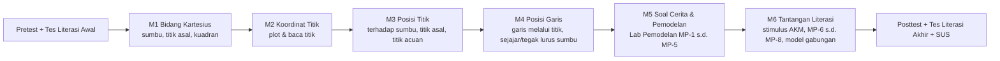

# 04 — Desain Pembelajaran

| Atribut | Keterangan |
|---------|------------|
| Versi | 1.0 |
| Tanggal | 10 November 2026 |
| Penyusun | Inayatul Sholihah |
| Acuan | Kurikulum Merdeka, Fase D (SMP); Buku Matematika SMP Kelas VIII Kemendikbudristek |

> Catatan: Rumusan Capaian Pembelajaran di bawah perlu dicocokkan kembali dengan dokumen CP resmi terbaru dan buku pegangan guru di sekolah uji coba.

## Daftar Isi
1. [Capaian & Tujuan Pembelajaran](#1-capaian--tujuan-pembelajaran)
2. [Peta Materi](#2-peta-materi)
3. [Struktur Modul](#3-struktur-modul)
4. [Rincian Modul](#4-rincian-modul)
5. [Strategi Beban Kognitif per Fitur](#5-strategi-beban-kognitif-per-fitur)
6. [Miskonsepsi yang Ditangani](#6-miskonsepsi-yang-ditangani)
7. [Asesmen](#7-asesmen)
8. [Pedoman Penulisan Konten](#8-pedoman-penulisan-konten)

---

## 1. Capaian & Tujuan Pembelajaran

**Capaian Pembelajaran (Fase D, elemen Aljabar/Geometri — ringkasan):** Peserta didik dapat menggunakan koordinat Kartesius untuk menjelaskan posisi relatif suatu titik/objek terhadap titik asal dan titik tertentu, serta posisi garis terhadap sumbu.

| Kode | Tujuan Pembelajaran (TP) | Modul |
|------|--------------------------|-------|
| TP-1 | Mengenal bidang Kartesius: sumbu X, sumbu Y, titik asal O(0, 0), dan empat kuadran | M1 |
| TP-2 | Menentukan dan membaca koordinat titik pada bidang Kartesius | M2 |
| TP-3 | Menentukan posisi titik terhadap sumbu X dan sumbu Y (jarak ke sumbu) | M3 |
| TP-4 | Menentukan posisi titik terhadap titik asal dan titik acuan tertentu | M3 |
| TP-5 | Menggambar garis yang melalui dua titik dan menentukan posisi garis terhadap sumbu (sejajar, tegak lurus, memotong) | M4 |
| TP-6 | Menyelesaikan masalah kontekstual (soal cerita) yang berkaitan dengan koordinat Kartesius | M5 |
| TP-7 | Merumuskan masalah kontekstual menjadi model matematika pada bidang Kartesius (titik acuan, rute, jarak, garis, bangun, skala, pola) | M5, M6 |
| TP-8 | Menafsirkan hasil penyelesaian model dalam konteks dan menilai kewajarannya dengan alasan | M5, M6 |

## 2. Peta Materi

## 3. Struktur Modul

Setiap modul mengikuti pola tetap (konsistensi menurunkan beban ekstrinsik — W-4):

| Segmen | Tujuan | Prinsip CLT | Durasi |
|--------|--------|-------------|--------|
| 1. **Pemantik** | Konteks sehari-hari singkat (1 gambar + 1 kalimat) | Mengaktifkan pengetahuan awal | 1 menit |
| 2. **Konsep** | 2–4 layar penjelasan, satu konsep per layar | Segmentasi, signaling | 3–5 menit |
| 3. **Contoh Lengkap** | Worked example animatif langkah demi langkah | Worked example effect | 2–3 menit |
| 4. **Contoh Dipudarkan** | Sebagian langkah diisi siswa | Fading / completion problem | 3 menit |
| 5. **Latihan** | 5–8 soal bertahap mudah → sedang → sulit | Practice, umpan balik segera | 8–10 menit |
| 6. **Refleksi & Kuesioner** | 1 pertanyaan "Apa yang kamu pelajari?" (pilihan) + skala Paas | Germane load, pengukuran | 1 menit |

Durasi total per modul ±20 menit (sesuai satu sesi belajar mandiri).

## 4. Rincian Modul

### M1 — Mengenal Bidang Kartesius (TP-1)
- **Pemantik:** Denah tempat duduk kelas — "Bagaimana memberi tahu posisi kursimu?"
- **Konsep:** (a) Garis mendatar = sumbu X (biru), garis tegak = sumbu Y (merah). (b) Titik potong = titik asal O(0, 0). (c) Arah positif/negatif. (d) Empat kuadran dan tanda (+/−).
- **Interaksi:** Ketuk area kuadran → kuadran disorot dan tanda (x, y) tampil.
- **Latihan:** Menebak kuadran dari tanda; mengetuk kuadran yang diminta.

### M2 — Koordinat Titik (TP-2) — menjawab W-2
- **Konsep:** Pasangan berurutan (x, y): "jalan mendatar dulu, baru naik/turun". Absis dan ordinat.
- **Contoh lengkap:** Animasi dari O → 3 langkah ke kanan → 2 langkah ke atas → titik A(3, 2).
- **Contoh dipudarkan:** Langkah mendatar sudah digambar, siswa melanjutkan langkah tegak.
- **Latihan:** Plot titik (ketuk), baca titik (isian), titik pada sumbu (mis. (0, −4)).

### M3 — Posisi Titik (TP-3, TP-4) — menjawab W-2
- **Konsep:** (a) Jarak titik ke sumbu X = |y|, ke sumbu Y = |x|. (b) Posisi terhadap titik asal. (c) Posisi terhadap titik acuan: "dari A, geser a satuan ke kanan/kiri dan b satuan ke atas/bawah".
- **Interaksi:** Mode titik acuan — panah langkah ditampilkan (horizontal biru, vertikal merah) dengan label jumlah satuan.
- **Latihan:** Menentukan titik B dari titik acuan A, menentukan posisi B terhadap A, mencari jarak titik ke sumbu.

### M4 — Posisi Garis (TP-5) — menjawab W-1
- **Konsep:** (a) Dua titik menentukan satu garis. (b) Garis sejajar sumbu X: semua titik memiliki y yang sama. (c) Garis sejajar sumbu Y: semua titik memiliki x yang sama. (d) Garis tegak lurus sumbu. (e) Garis yang memotong sumbu.
- **Contoh lengkap:** Plot P → plot Q → garis tergambar → sorot nilai y yang sama.
- **Interaksi:** Seret titik dan amati perubahan garis serta keterangan posisi garis secara real-time.
- **Latihan:** Menggambar garis melalui dua titik; menentukan posisi garis terhadap sumbu; menggambar garis melalui titik tertentu yang sejajar sumbu X/Y.

### M5 — Soal Cerita & Pemodelan (TP-6, TP-7, TP-8) — menjawab W-3
- **Konteks:** Denah sekolah, peta desa, posisi bidak pada papan permainan, rute kurir.
- **Pengenalan siklus pemodelan:** satu layar memperkenalkan 5 langkah (Pahami → Rumuskan → Selesaikan → Tafsirkan → Periksa) dengan Contoh A dari [13-literasi-dan-pemodelan.md](13-literasi-dan-pemodelan.md#8-contoh-pemodelan-lengkap) sebagai worked example.
- **Model yang dilatih:** MP-1 (titik acuan), MP-2 (rute berantai), MP-3 (jarak), MP-4 (posisi relatif), MP-5 (garis sejajar sumbu).
- **Pola penyajian** (dipakai di langkah ① Pahami):
  1. Teks pendek (≤ 3 kalimat, ≤ 15 kata per kalimat), angka & kata kunci disorot.
  2. Ilustrasi denah berada langsung di dekat teks (bukan di halaman lain).
  3. Panel **Diketahui** (poin-poin) dan **Ditanya** (satu kalimat).
  4. Panel **Langkah** yang terbuka satu per satu.
  5. Jawaban dikerjakan langsung di kanvas.
- **Fading:** Mudah = Diketahui/Ditanya terisi otomatis → Sedang = siswa mengetuk informasi penting di teks → Sulit = siswa menulis/memilih sendiri.
- **Pemodelan:** setelah langkah ①, siswa melanjutkan ke ② Rumuskan, ③ Selesaikan (dengan mesin model), ④ Tafsirkan, dan ⑤ Periksa.

### M6 — Tantangan Literasi (TP-7, TP-8) — literasi matematika
- **Tujuan:** menerapkan siklus pemodelan pada konteks yang lebih kaya dan melatih penalaran.
- **Model tambahan:** MP-6 (bangun datar dengan sisi sejajar sumbu), MP-7 (skala, termasuk skala luas), MP-8 (pola titik), serta **model gabungan** (mis. rute + skala, bangun + skala).
- **Bentuk:** 2–3 **stimulus literasi** bergaya AKM (denah desa, peta wisata, tata letak taman). Tiap stimulus memuat 3–5 butir dari Pemahaman → Penerapan → Penalaran.
- **Konteks:** personal, sosial budaya, saintifik (seimbang).
- **Penutup:** refleksi "Model mana yang paling sering kamu pakai? Kapan kamu tahu harus memakai skala?" dan **Pemodel Bebas** diperkenalkan sebagai alat belajar mandiri.

### Integrasi Literasi di Semua Modul
Literasi tidak hanya dilatih di M5–M6:
- **M1–M4:** setiap modul ditutup dengan 1 soal kontekstual singkat (konteks nyata + pertanyaan "Mengapa?").
- **Pemantik** setiap modul memakai situasi nyata yang nantinya dimodelkan.
- **Kartu Model** yang sudah dipelajari otomatis terbuka di koleksi siswa, mis. M3 membuka MP-1 & MP-4, M4 membuka MP-5.

## 5. Strategi Beban Kognitif per Fitur

| Prinsip (Mayer & Sweller) | Penerapan di Aplikasi | Fitur |
|---------------------------|----------------------|-------|
| Segmentasi | Satu konsep per layar, tombol "Lanjut" | F-06 |
| Signaling | Warna konsisten sumbu (X biru, Y merah), highlight angka soal | F-02, F-08 |
| Spatial contiguity (anti split-attention) | Label koordinat di dekat titik; ilustrasi di dekat teks soal | F-02, F-08 |
| Coherence | Tanpa dekorasi/animasi yang tidak relevan, tanpa musik latar | Semua |
| Redundancy | Tidak menampilkan teks dan audio identik bersamaan (audio opsional) | F-19 |
| Worked example & fading | Contoh lengkap → dipudarkan → mandiri | F-06, F-08 |
| Pre-training | Tutorial & M1 memperkenalkan istilah sebelum soal | F-01 |
| Learner control | Siswa mengatur kecepatan, dapat mengulang contoh | F-06 |
| Feedback | Umpan balik segera, spesifik, menjelaskan "mengapa" | F-09 |
| Manipulasi langsung (embodied) | Seret titik, panah langkah | F-02–F-05 |
| Siklus pemodelan terstruktur | 5 langkah tetap dengan pemeriksaan per langkah memecah tugas kompleks | F-22 |
| Self-explanation | Langkah ⑤ Periksa meminta alasan kewajaran | F-22, F-24 |

## 6. Miskonsepsi yang Ditangani

| Kode | Miskonsepsi | Deteksi | Umpan Balik |
|------|-------------|---------|-------------|
| MK-1 | x dan y tertukar | Jawaban = (y, x) dari kunci | "Sepertinya x dan y tertukar. (x, y) = (mendatar, tegak)." |
| MK-2 | Tanda negatif terabaikan | \|x\|,\|y\| sama, tanda berbeda | "Perhatikan arah: kiri dan bawah bernilai negatif." |
| MK-3 | Menghitung dari titik asal, bukan dari titik acuan | Jawaban = (a, b) alih-alih A + (a, b) | "Mulailah dari titik acuan, bukan dari O(0, 0)." |
| MK-4 | Garis sejajar sumbu X dikira sejajar sumbu Y | Pilihan sumbu terbalik | "Garis sejajar sumbu X arahnya mendatar; nilai y semua titik sama." |
| MK-5 | Jarak ke sumbu X dihitung dengan x | Jawaban = \|x\| | "Jarak ke sumbu X diukur tegak, jadi lihat nilai y." |
| MK-6 | Menghitung garis grid, bukan satuan/jarak | Selisih ±1 | "Hitung loncatannya, bukan garisnya." |

Miskonsepsi terkait pemodelan dan literasi (MK-7 s.d. MK-12) dijelaskan di [13-literasi-dan-pemodelan.md §10](13-literasi-dan-pemodelan.md#10-miskonsepsi-tambahan).

## 7. Asesmen

| Jenis | Waktu | Bentuk | Jumlah |
|-------|-------|--------|--------|
| Pretest | Sebelum M1 | Campuran (plot, PG, soal cerita) | 10 soal |
| Formatif | Tiap modul | Latihan interaktif + umpan balik | 5–8 soal/modul |
| Posttest | Setelah M6 | Setara pretest (paralel) | 10 soal |
| Tes literasi awal & akhir | Bersama pretest/posttest | 2 stimulus × 4–5 butir (paralel) | 8–10 butir |
| Lab Pemodelan | M5–M6 | Skor per langkah → profil literasi | 4–6 soal/modul |
| Beban kognitif | Setelah tiap modul & soal cerita | Skala Paas 1–9 | 1 butir |
| Kegunaan | Setelah posttest | SUS | 10 butir |

**Penskoran latihan:** 100 poin per soal; hint level 1/2/3 → maksimal 90/75/60. Bintang modul: ≥ 85 = 3★, ≥ 70 = 2★, ≥ 50 = 1★.

## 8. Pedoman Penulisan Konten

1. Kalimat ≤ 15 kata, paragraf ≤ 3 kalimat.
2. Satu istilah baru per layar; istilah baru dicetak tebal saat pertama muncul.
3. Gunakan "kamu", nada ramah dan menyemangati.
4. Angka ditulis dengan digit; koordinat selalu dalam format `(x, y)` dengan tanda minus "−" yang jelas.
5. Hindari konteks yang bias gender/daerah/ekonomi; gunakan nama dan lokasi yang beragam.
6. Setiap soal cerita wajib memiliki ilustrasi atau denah.
7. Semua konten divalidasi ahli materi sebelum uji coba.
