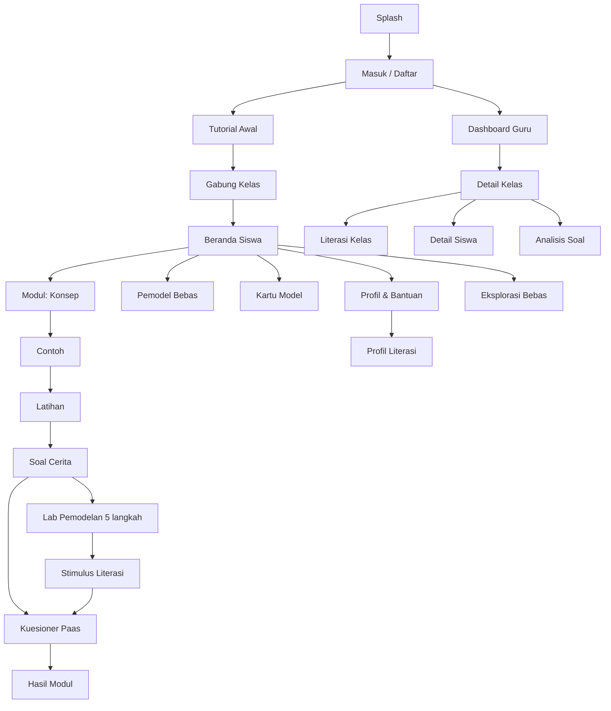

# 06 — Pedoman UI/UX

| Atribut | Keterangan |
|---------|------------|
| Versi | 1.0 |
| Tanggal | 10 November 2026 |
| Penyusun | Inayatul Sholihah |

## Daftar Isi
1. [Prinsip Desain](#1-prinsip-desain)
2. [Design Tokens](#2-design-tokens)
3. [Komponen Inti](#3-komponen-inti)
4. [Peta Layar](#4-peta-layar)
5. [Wireframe](#5-wireframe)
6. [Aksesibilitas](#6-aksesibilitas)
7. [Microcopy](#7-microcopy)

---

## 1. Prinsip Desain

1. **Sederhana dulu (W-4).** Maksimal **3 aksi utama** per layar. Satu tombol utama yang menonjol.
2. **Satu layar, satu tujuan.** Tidak mencampur materi dan navigasi kompleks.
3. **Konsisten.** Posisi tombol "Kembali", "Petunjuk", "Periksa", dan "Lanjut" selalu sama.
4. **Kanvas adalah pusat.** Pada layar latihan, kanvas menempati ≥ 55% tinggi layar HP.
5. **Signaling dengan warna bermakna**, bukan dekorasi.
6. **Mobile-first.** Didesain untuk 360 × 640 px potret, lalu diperluas ke tablet/desktop.
7. **Umpan balik selalu terlihat** di dekat area kerja (bottom sheet), tidak menutupi kanvas.

## 2. Design Tokens

### 2.1 Warna

| Token | Hex | Penggunaan |
|-------|-----|-----------|
| `primary-600` | `#2563EB` | Tombol utama, tautan |
| `axis-x` | `#2563EB` | Sumbu X & langkah mendatar (biru) |
| `axis-y` | `#DC2626` | Sumbu Y & langkah tegak (merah) |
| `point-active` | `#F97316` | Titik yang sedang dipilih/dibuat siswa (oranye) |
| `point-given` | `#475569` | Titik yang diberikan soal (abu tua) |
| `line-answer` | `#16A34A` | Garis jawaban (hijau) |
| `success` | `#16A34A` | Umpan balik benar |
| `warning` | `#D97706` | Petunjuk |
| `error` | `#DC2626` | Umpan balik salah (dengan ikon, bukan warna saja) |
| `highlight-bg` | `#FEF08A` | Sorotan angka/kata kunci soal cerita |
| `grid` | `#E2E8F0` | Garis grid |
| `bg` | `#F8FAFC` | Latar belakang |
| `text` | `#0F172A` | Teks utama |
| `text-muted` | `#475569` | Teks sekunder |

> Karena sumbu Y dan "error" sama-sama merah, umpan balik salah **selalu** disertai ikon dan teks, dan ditampilkan di bottom sheet, bukan di kanvas.

### 2.2 Tipografi
- Font: **Nunito** (ramah, mudah dibaca) atau fallback `system-ui`.
- Skala: 14 (keterangan), 16 (isi, minimum), 18 (soal), 22 (judul layar), 28 (judul besar).
- Line-height 1.5; lebar baris teks maksimal 60 karakter.
- Angka koordinat memakai font tabular (`font-variant-numeric: tabular-nums`).

### 2.3 Spasi, Bentuk, Gerak
- Spasi kelipatan 4 px (4, 8, 12, 16, 24, 32).
- Radius: 12 px (kartu), 999 px (tombol pil).
- Target sentuh minimum **48 × 48 dp**; titik kanvas memiliki area sentuh radius 24 px walau tampil 8 px.
- Animasi 150–300 ms, *ease-out*; hormati `prefers-reduced-motion`.

## 3. Komponen Inti

| Komponen | Deskripsi |
|----------|-----------|
| `CartesianCanvas` | Grid, sumbu berlabel, angka skala, titik, garis, panah langkah; mendukung tap, drag, tombol panah, pinch-zoom sederhana |
| `CoordinateLabel` | Label "(x, y)" melekat di samping titik, otomatis menghindari tepi |
| `StepArrow` | Panah horizontal (biru) / vertikal (merah) berlabel jumlah satuan |
| `QuestionCard` | Teks soal dengan sorotan |
| `StoryPanel` | Tab "Diketahui", "Ditanya", "Langkah" (accordion) |
| `HintButton` | Membuka hint bertingkat, memberi tahu pengurangan skor |
| `FeedbackSheet` | Bottom sheet benar/salah + penjelasan + tombol lanjut |
| `ProgressRing` | Persentase modul + bintang |
| `CoachMark` | Penanda tutorial (sorot area + teks singkat) |
| `PaasScale` | 9 tombol skala dengan label ujung "Sangat sangat mudah" – "Sangat sangat sulit" |
| `ModelingStepper` | 5 ikon langkah tetap: 🔍 Pahami, 🧩 Rumuskan, ✏️ Selesaikan, 💬 Tafsirkan, ✅ Periksa; status (aktif/selesai/terkunci) |
| `TokenText` | Teks cerita yang dapat diketuk per frasa; token terpilih dapat diseret ke kotak Diketahui/Ditanya |
| `ModelCard` | Kartu model MP-1 s.d. MP-8: nama, ikon, "dipakai jika…", notasi |
| `ModelBuilder` | Isian parameter model dengan kosakata cerita (pilihan arah utara/timur/…) dan pratinjau notasi |
| `SolutionPlayer` | Menampilkan `steps[]` dari mesin model satu per satu, sinkron dengan animasi kanvas |
| `StimulusPanel` | Denah/tabel stimulus yang dapat disematkan (*pin*) di atas butir soal |
| `LiteracyProfileChart` | Diagram batang 3 proses literasi + kategori |

## 4. Peta Layar



## 5. Wireframe

### 5.1 Beranda Siswa (HP)
```
┌──────────────────────────────┐
│ Hai, Raka 👋        [?] [👤] │
│ Kelas VIII-A                 │
├──────────────────────────────┤
│ ┌──────────────────────────┐ │
│ │ M1 Bidang Kartesius  ★★★ │ │
│ │ ████████████ 100%        │ │
│ └──────────────────────────┘ │
│ ┌──────────────────────────┐ │
│ │ M2 Koordinat Titik   ★☆☆ │ │
│ │ ██████░░░░░░ 50%         │ │
│ │            [ Lanjutkan ] │ │
│ └──────────────────────────┘ │
│ ┌──────────────────────────┐ │
│ │ 🔒 M3 Posisi Titik       │ │
│ └──────────────────────────┘ │
│  ...                         │
├──────────────────────────────┤
│  [🏠 Beranda] [🧭 Eksplor] [👤 Saya] │
└──────────────────────────────┘
```

### 5.2 Latihan Plot Titik (HP)
```
┌──────────────────────────────┐
│ ←  M2 · Soal 3/6       [💡]  │
├──────────────────────────────┤
│ Taruh titik  A(4, 2)         │
│              ^^^^^^ disorot  │
├──────────────────────────────┤
│        y                     │
│        ↑   ·  ·  ·  ·        │
│        │   ·  ·  ● (4, 2)    │
│        │   ·  ·  ·  ·        │
│  ──────O──────────────→ x    │
│        │                     │
│      (kanvas ≥ 55% layar)    │
├──────────────────────────────┤
│   [◀][▲][▼][▶]   [ Periksa ] │
└──────────────────────────────┘
```

### 5.3 Soal Cerita Terstruktur (HP)
```
┌──────────────────────────────┐
│ ←  M5 · Soal Cerita 1   [💡] │
├──────────────────────────────┤
│ [ilustrasi denah sekolah]    │
│ Gerbang di (0, 0).           │
│ Perpustakaan di (4, 3).      │
│ Kantin 6 satuan ke kiri dari │
│ perpustakaan. Di mana kantin?│
├──────────────────────────────┤
│ ▼ Diketahui                  │
│   • Perpustakaan (4, 3)      │
│   • Kantin: 6 ke kiri        │
│ ▶ Ditanya                    │
│ ▶ Langkah                    │
├──────────────────────────────┤
│ [ kanvas jawaban ]           │
│                  [ Periksa ] │
└──────────────────────────────┘
```

### 5.4 Umpan Balik (bottom sheet)
```
┌──────────────────────────────┐
│ ✖ Belum tepat                │
│ Kamu menghitung dari O(0,0). │
│ Mulailah dari titik A.       │
│ [ Coba lagi ]   [ Petunjuk ] │
└──────────────────────────────┘
```

### 5.4a Lab Pemodelan — Langkah ② Rumuskan (HP)
```
┌──────────────────────────────┐
│ ←  M5 · Pemodelan 2     [💡] │
│ 🔍──🧩──✏️──💬──✅            │
│ ✔   ●                        │
├──────────────────────────────┤
│ ▸ Cerita (ketuk untuk buka)  │
│ Diketahui: (1,−2) · 4 utara ·│
│ 5 barat · 1 selatan · 100 m  │
├──────────────────────────────┤
│ Pilih model:                 │
│ [Titik Acuan] [Rute Berantai✓] [Jarak] │
├──────────────────────────────┤
│ Mulai dari: ( 1 , −2 )       │
│ 1. [utara ▾]  [ 4 ] satuan   │
│ 2. [barat ▾]  [ 5 ] satuan   │
│ 3. [selatan▾] [ 1 ] satuan   │
│ [+ langkah]                  │
│ Model: P = (1 − 5, −2 + 4 − 1)│
├──────────────────────────────┤
│ [ kanvas pratinjau rute ]    │
│            [ Periksa langkah ]│
└──────────────────────────────┘
```

### 5.4b Pemodel Bebas — Hasil (HP)
```
┌──────────────────────────────┐
│ ← Pemodel Bebas: Bangun Datar│
├──────────────────────────────┤
│ A(−3,−1) B(5,−1) C(5,3)      │
│ Skala: 1 satuan = 2 m        │
├──────────────────────────────┤
│ [ kanvas: persegi panjang ]  │
├──────────────────────────────┤
│ Langkah 2 dari 5        [▶]  │
│ Panjang = |5 − (−3)| = 8     │
│ satuan = 16 m                │
├──────────────────────────────┤
│ Jawaban: D(−3, 3), L = 128 m²│
│ [ Simpan ]   [ Ubah data ]   │
└──────────────────────────────┘
```

### 5.5 Dashboard Guru (desktop)
```
┌──────────────────────────────────────────────────────────┐
│ KartesiusKu Guru      Kelas: [VIII-A ▾]   Kode: K7P2QX [⧉]│
├────────────┬─────────────────────────────────────────────┤
│ Ringkasan  │ 28 siswa · 64% selesai · rata-rata skor 78  │
│ Siswa      │ ┌─────────────────────────────────────────┐ │
│ Analisis   │ │ Nama      M1  M2  M3  M4  M5  M6  Rata  Aktif│ │
│ Literasi   │ │ Ani       ★3  ★2  ★2  —   —   —   81   hari ini│
│ Ekspor     │ │ Budi ⚠    ★1  ★1  —   —   —   —   52   3 hr  │ │
│ Pengaturan │ └─────────────────────────────────────────┘ │
│            │ Soal tersulit: m4-line-002 (38% benar)       │
│            │ Literasi: Merumuskan 58 · Menerapkan 76 ·    │
│            │ Menafsirkan 61 → 12 siswa lemah Merumuskan   │
└────────────┴─────────────────────────────────────────────┘
```

## 6. Aksesibilitas

- Kontras teks minimal 4,5 : 1 (WCAG AA).
- Informasi tidak hanya lewat warna: sumbu diberi label "X" dan "Y"; benar/salah memakai ikon ✔/✖.
- Alternatif seret: tombol panah dan input angka untuk menaruh titik.
- Semua tombol ikon memiliki `aria-label`; kanvas memiliki deskripsi teks (mis. "Titik A di (4, 2), kuadran I").
- Ukuran font dapat diperbesar (pengaturan 100% / 115% / 130%).
- Mendukung navigasi keyboard di web.

## 7. Microcopy

| Situasi | Teks |
|---------|------|
| Benar | "Tepat! 🎉" + satu kalimat alasan |
| Salah | "Belum tepat." + petunjuk spesifik (tidak memakai kata "Salah!") |
| Buka hint | "Petunjuk akan mengurangi skor maksimal soal ini menjadi 90. Lanjut?" |
| Offline | "Kamu sedang offline. Jawabanmu disimpan dan dikirim nanti." |
| Modul selesai | "Hebat, modul selesai! Kamu dapat ★★☆." |
| Kode kelas salah | "Kode kelas tidak ditemukan. Cek lagi ke gurumu, ya." |
