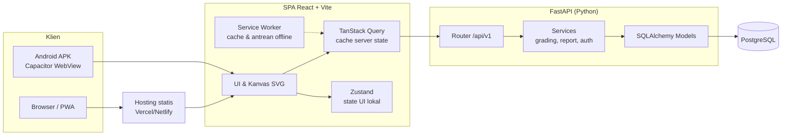
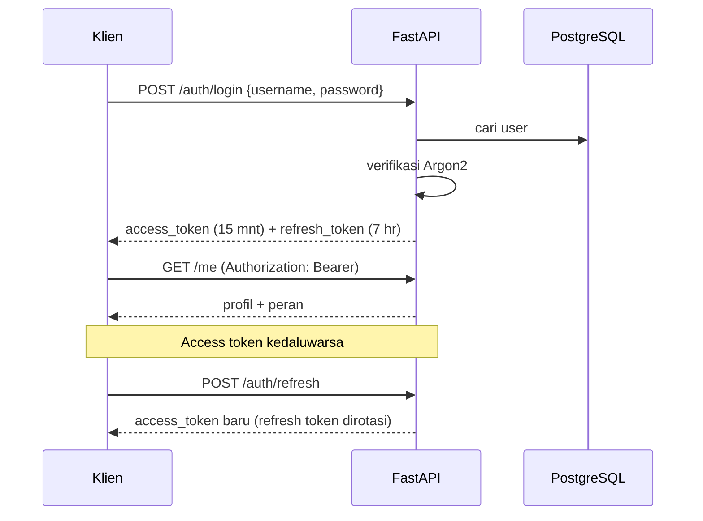
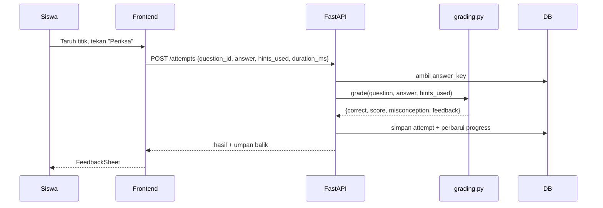
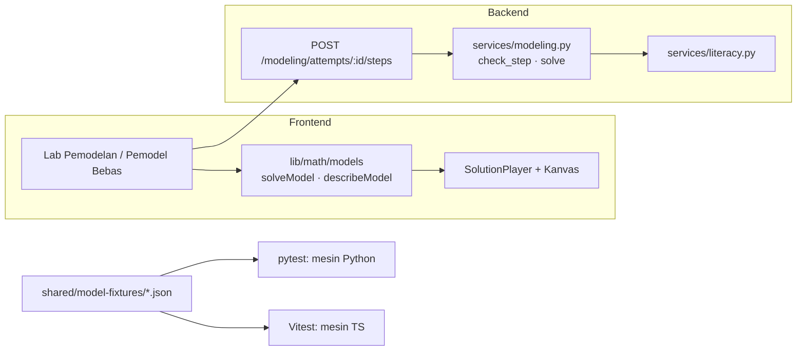

# 07 — Arsitektur Sistem

| Atribut | Keterangan |
|---------|------------|
| Versi | 1.0 |
| Tanggal | 10 November 2026 |
| Penyusun | Inayatul Sholihah |

## Daftar Isi
1. [Gambaran Umum](#1-gambaran-umum)
2. [Diagram Arsitektur](#2-diagram-arsitektur)
3. [Frontend](#3-frontend)
4. [Backend](#4-backend)
5. [Alur Autentikasi](#5-alur-autentikasi)
6. [Alur Menjawab Soal](#6-alur-menjawab-soal)
7. [Strategi Offline](#7-strategi-offline)
8. [Build Multi-Platform](#8-build-multi-platform)
9. [Keputusan Arsitektur (ADR)](#9-keputusan-arsitektur-adr)

---

## 1. Gambaran Umum

Arsitektur **client–server** dengan satu Single Page Application (SPA) React yang dipakai di web (PWA) dan Android (Capacitor WebView), serta REST API FastAPI yang terhubung ke PostgreSQL.

## 2. Diagram Arsitektur



## 3. Frontend

### 3.1 Teknologi
React 18 · Vite · TypeScript · Tailwind CSS · React Router v6 · TanStack Query v5 · Zustand · React Hook Form + Zod · vite-plugin-pwa · Capacitor · Vitest · Playwright.

### 3.2 Struktur Folder
```
frontend/
├── src/
│   ├── app/
│   │   ├── router.tsx            # rute & guard per peran
│   │   ├── providers.tsx         # QueryClient, Theme
│   │   └── layouts/              # StudentLayout, TeacherLayout
│   ├── features/
│   │   ├── auth/                 # LoginPage, RegisterPage, JoinClassPage, useAuth
│   │   ├── onboarding/           # TutorialOverlay, CoachMark
│   │   ├── canvas/
│   │   │   ├── CartesianCanvas.tsx
│   │   │   ├── Grid.tsx, Axes.tsx, Point.tsx, Line.tsx, StepArrow.tsx
│   │   │   ├── useCanvasTransform.ts  # konversi koordinat dunia ↔ layar
│   │   │   └── usePointerDrag.ts      # pointer events + snap
│   │   ├── lessons/              # LessonPlayer, SegmentRenderer
│   │   ├── practice/             # QuestionRenderer, per-tipe soal, StoryPanel, HintButton, FeedbackSheet
│   │   ├── progress/             # HomePage, ModuleCard
│   │   ├── modeling/             # ModelingLab (stepper 5 langkah), TokenText, ModelCard, ModelBuilder, SolutionPlayer, FreeModeler
│   │   ├── literacy/             # StimulusPage, StimulusPanel, LiteracyProfile
│   │   ├── survey/               # PaasScale, SusForm
│   │   └── teacher/              # Dashboard, ClassDetail, StudentDetail, ItemAnalysis
│   ├── components/ui/            # Button, Card, Sheet, Modal, Tabs
│   ├── lib/
│   │   ├── api/                  # client fetch + interceptor token
│   │   ├── math/                 # quadrant.ts, onLine.ts, relative.ts (fungsi murni)
│   │   │   └── models/           # mesin model: types.ts, solve.ts, checkStep.ts, describe.ts, solvers/{translate,routeChain,...}.ts
│   │   └── offline/              # antrean jawaban (IndexedDB)
│   ├── content/                  # teks UI & materi statis (id-ID)
│   └── main.tsx
├── public/                       # ikon, ilustrasi SVG
├── android/                      # proyek Android (Capacitor)
├── capacitor.config.ts
└── vite.config.ts
```

### 3.3 Desain Kanvas
- Koordinat dunia (−10…10) dipetakan ke koordinat layar oleh `useCanvasTransform` (skala, offset, flip sumbu Y).
- Interaksi memakai **Pointer Events** (satu API untuk mouse & sentuh), `touch-action: none` pada kanvas.
- Snap: `Math.round` ke bilangan bulat setelah konversi.
- Kanvas bersifat **controlled component**: menerima `points`, `lines`, `arrows`, `mode` dan memanggil `onChange`, sehingga mudah diuji dan dipakai ulang di materi, latihan, dan dashboard guru (replay jawaban).

### 3.4 State
- **Server state** (user, modul, soal, progres): TanStack Query.
- **UI state** (titik sementara di kanvas, tutorial sudah dilihat, ukuran font): Zustand + `localStorage`/Capacitor Preferences.
- Token: access token di memori; refresh token di `httpOnly` cookie (web) / Capacitor Secure Storage (Android).

## 4. Backend

### 4.1 Teknologi
Python 3.12 · FastAPI · Uvicorn · SQLAlchemy 2 (async, asyncpg) · Alembic · Pydantic v2 + pydantic-settings · passlib/argon2-cffi · PyJWT · slowapi (rate limit) · pytest + httpx.

### 4.2 Struktur Folder
```
backend/
├── app/
│   ├── main.py                 # inisialisasi FastAPI, CORS, router
│   ├── core/
│   │   ├── config.py           # Settings dari .env
│   │   ├── security.py         # hash, JWT
│   │   ├── deps.py             # get_db, get_current_user, require_role
│   │   └── errors.py           # format error standar
│   ├── api/v1/
│   │   ├── auth.py  classes.py  modules.py  questions.py
│   │   ├── attempts.py  progress.py  teacher.py  surveys.py  admin.py
│   ├── models/                 # user.py, class_.py, module.py, question.py, attempt.py, survey.py
│   ├── schemas/                # Pydantic request/response
│   ├── services/
│   │   ├── grading.py          # penilaian & deteksi miskonsepsi (fungsi murni)
│   │   ├── progress.py
│   │   ├── reports.py          # analisis soal, ekspor CSV
│   │   ├── modeling.py         # mesin model Python (solve, check_step, describe) — penilaian resmi
│   │   ├── literacy.py         # profil literasi per siswa/kelas
│   │   └── class_code.py
│   ├── seed/                   # modules.json, questions/*.json, __main__.py
│   └── db.py
├── alembic/
├── tests/
│   ├── unit/test_grading.py
│   └── api/test_auth.py, test_attempts.py, test_teacher_access.py
├── pyproject.toml
└── .env.example
```

### 4.3 Lapisan
`Router` (validasi & HTTP) → `Service` (logika bisnis & otorisasi kepemilikan) → `Model/DB`. Router tidak boleh mengakses DB langsung untuk logika kompleks.

## 5. Alur Autentikasi



## 6. Alur Menjawab Soal



`answer_key` tidak pernah dikirim ke klien sebelum soal terjawab benar atau batas percobaan habis. Frontend boleh melakukan **pre-check** lokal untuk respons instan saat offline, tetapi skor resmi berasal dari backend.

## 6a. Mesin Model & Lab Pemodelan



- **Pemodel Bebas** berjalan sepenuhnya di frontend (mesin TS), sehingga dapat dipakai offline dan tidak membebani server. Hasil hanya dikirim ke server jika disimpan.
- **Lab Pemodelan** mengirim jawaban **per langkah** ke backend. Backend memeriksa langkah dengan mesin Python, menyimpan skor langkah beserta proses literasinya, lalu mengembalikan umpan balik.
- Mesin model dirancang sebagai **registry** `kind → solver`, sehingga model baru (mis. persamaan garis pada versi berikutnya) dapat ditambahkan tanpa mengubah kode lain.
- Pada build/seed, validator menjalankan `solve(model_key)` dan membandingkannya dengan `solve_key` di setiap soal.

## 7. Strategi Offline

1. **Aset statis** (JS, CSS, ilustrasi) di-*precache* service worker (Workbox via vite-plugin-pwa).
2. **Konten modul & soal** yang sudah dibuka disimpan di cache TanStack Query yang dipersist ke IndexedDB.
3. Untuk mode offline, endpoint `GET /modules/{id}/bundle` mengirim soal beserta **kunci terenkripsi ringan/hash** sehingga pre-check lokal bisa dilakukan; skor tetap dihitung ulang server saat sinkron.
4. **Jawaban offline** masuk antrean IndexedDB (`pendingAttempts`) dan dikirim ulang otomatis saat `online`, dengan `client_attempt_id` (UUID) agar idempoten.

> Mode offline berstatus **Should** — dapat ditunda bila waktu terbatas.

## 8. Build Multi-Platform

| Target | Perintah | Keluaran |
|--------|----------|----------|
| Web/PWA | `npm run build` | `frontend/dist/` → Vercel/Netlify |
| Android | `npm run build && npx cap sync android` lalu build di Android Studio | APK/AAB bertanda tangan |

Konfigurasi Capacitor: `appId: "id.ac.kartesiusku.app"` (sesuaikan), `webDir: "dist"`, `server.androidScheme: "https"`. API diakses lewat URL absolut (`VITE_API_URL`); CORS backend mengizinkan origin web dan `https://localhost` (Capacitor).

## 9. Keputusan Arsitektur (ADR)

| ID | Keputusan | Alasan | Alternatif yang Ditolak |
|----|-----------|--------|--------------------------|
| ADR-01 | React + Vite + Capacitor untuk web & Android | Satu basis kode, ekosistem besar, sesuai pilihan pengembang | Flutter (kurva belajar), React Native (web kurang matang) |
| ADR-02 | FastAPI (Python) | Sesuai pilihan pengembang, dokumentasi otomatis OpenAPI, async, cepat | Django (lebih berat), Flask (validasi manual) |
| ADR-03 | Kanvas SVG kustom | Kendali penuh atas UX pedagogis (warna, panah, snap), ringan | JSXGraph/GeoGebra (berat, sulit dikustomisasi untuk HP murah), Mafs (opsi cadangan) |
| ADR-04 | PostgreSQL + JSONB untuk konten soal | Fleksibel untuk berbagai tipe soal, tetap relasional untuk laporan | MongoDB (laporan relasional lebih sulit) |
| ADR-05 | Penilaian final di backend | Mencegah manipulasi skor, data penelitian valid | Penilaian di klien saja |
| ADR-06 | Siswa login dengan username (tanpa email) | Data minimal untuk anak di bawah umur | Email/Google login |
| ADR-07 | Pemodelan berbasis templat + mesin model deterministik, **tanpa AI** | Hasil pasti benar & dapat diuji, offline, tanpa biaya, privasi anak terjaga | LLM/NLP untuk membaca soal bebas (tidak akurat, butuh internet & biaya, risiko privasi) |
| ADR-08 | Mesin model diimplementasikan dua kali (TS & Python) dengan fixture bersama | FE perlu offline & animasi instan; BE perlu penilaian resmi | Hanya BE (tidak bisa offline), hanya FE (skor mudah dimanipulasi) |
