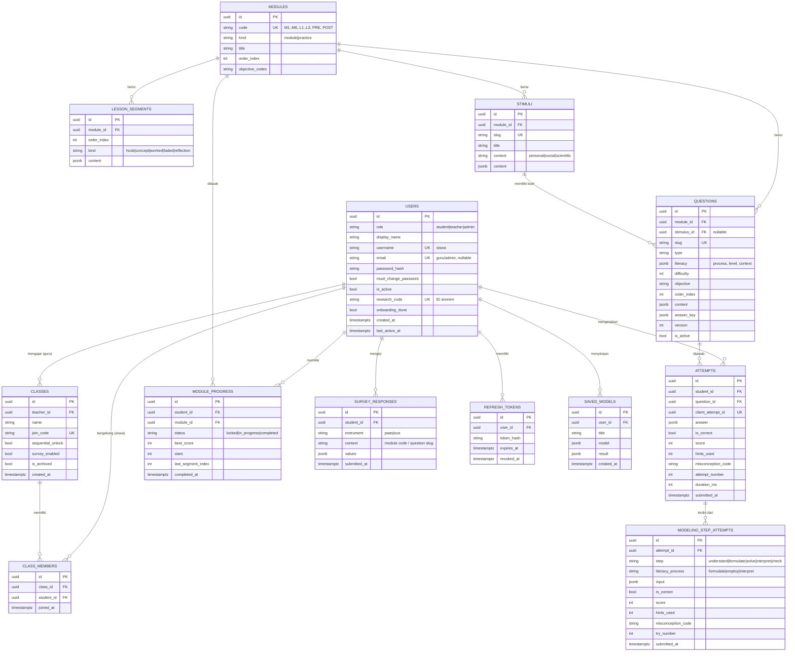

# 08 — Skema Basis Data

| Atribut | Keterangan |
|---------|------------|
| Versi | 1.0 |
| Tanggal | 10 November 2026 |
| Penyusun | Inayatul Sholihah |
| DBMS | PostgreSQL 16 (produksi), SQLite (pengembangan) |

## Daftar Isi
1. [ERD](#1-erd)
2. [Definisi Tabel](#2-definisi-tabel)
3. [Indeks & Batasan](#3-indeks--batasan)
4. [Aturan Data & Retensi](#4-aturan-data--retensi)

---

## 1. ERD

## 2. Definisi Tabel

### 2.1 `users`
| Kolom | Tipe | Null | Keterangan |
|-------|------|------|------------|
| id | UUID | ✗ | PK |
| role | VARCHAR(10) | ✗ | `student`, `teacher`, `admin` (CHECK) |
| display_name | VARCHAR(60) | ✗ | Nama tampilan |
| username | VARCHAR(30) | ✓ | Unik; wajib untuk siswa; pola `^[a-z0-9_.]{3,30}$` |
| email | VARCHAR(255) | ✓ | Unik; wajib untuk guru/admin |
| password_hash | TEXT | ✗ | Argon2id |
| must_change_password | BOOLEAN | ✗ | Default `false`; `true` setelah direset guru |
| is_active | BOOLEAN | ✗ | Default `true` |
| research_code | VARCHAR(12) | ✗ | Unik, acak; dipakai pada ekspor penelitian |
| onboarding_done | BOOLEAN | ✗ | Default `false` |
| created_at, last_active_at | TIMESTAMPTZ | ✗/✓ | |

### 2.2 `classes`
| Kolom | Tipe | Keterangan |
|-------|------|------------|
| id | UUID | PK |
| teacher_id | UUID | FK → users.id (role teacher) |
| name | VARCHAR(50) | mis. "VIII-A" |
| join_code | CHAR(6) | Unik; alfabet `ABCDEFGHJKLMNPQRSTUVWXYZ23456789` |
| sequential_unlock | BOOLEAN | Default `true` |
| survey_enabled | BOOLEAN | Default `false` |
| is_archived | BOOLEAN | Default `false` |

### 2.3 `class_members`
| Kolom | Tipe | Keterangan |
|-------|------|------------|
| class_id, student_id | UUID | FK; UNIQUE(class_id, student_id) |
| joined_at | TIMESTAMPTZ | |

Aturan: satu siswa hanya boleh di satu kelas **aktif** (ditegakkan di service).

### 2.4 `modules` & `lesson_segments`
Konten statis yang dimuat dari seed. Kolom `kind`: `module` = modul materi (M1–M6), `practice` = level Latihan Soal (L1 Mudah, L2 Sedang, L3 Sulit; migrasi `03ab8b0152fc`). Level latihan selalu terbuka berurutan dan tidak memiliki segmen materi. `lesson_segments.content` (JSONB) berisi teks, gambar, dan konfigurasi kanvas untuk segmen tersebut.

### 2.5 `questions`
`content` menyimpan semua field soal selain `answer_key` (lihat [05-bank-soal-spesifikasi.md](05-bank-soal-spesifikasi.md)). `answer_key` disimpan terpisah agar mudah dikecualikan dari respons API. `version` naik setiap revisi; attempts menyimpan `question_id` sehingga revisi besar sebaiknya membuat baris baru (slug baru) agar data penelitian konsisten.

### 2.6 `attempts`
Satu baris per pengiriman jawaban. `client_attempt_id` unik untuk idempotensi sinkronisasi offline. `attempt_number` = urutan percobaan siswa untuk soal tersebut.

### 2.7 `module_progress`
UNIQUE(student_id, module_id). Diperbarui oleh `services/progress.py` setiap attempt.

### 2.8 `survey_responses`
- Paas: `values = {"rating": 1..9}`
- SUS: `values = {"q1": 1..5, ..., "q10": 1..5, "score": 0..100}`

### 2.9 `refresh_tokens`
Menyimpan **hash** refresh token untuk rotasi & pencabutan.

### 2.10 `stimuli`
Stimulus literasi bergaya AKM (denah, peta, tabel). `content` berisi ilustrasi, tabel data, dan skala. Butir soal merujuk melalui `questions.stimulus_id`.

### 2.11 `modeling_step_attempts`
Satu baris per pengiriman **satu langkah** pada soal `modeling`. `attempts` (induk) menyimpan skor total soal; tabel ini menyimpan skor per langkah dan `literacy_process` yang menjadi dasar **profil literasi**. UNIQUE tidak diterapkan karena satu langkah bisa dicoba beberapa kali (`try_number`).

### 2.12 `saved_models`
Model yang disimpan pengguna dari **Pemodel Bebas**. Tidak memengaruhi nilai. Dibatasi 100 model per pengguna.

### 2.13 Perhitungan Profil Literasi
Profil dihitung dengan *query* agregat (bukan tabel terpisah) dari `modeling_step_attempts` (skor percobaan terbaik per langkah) dan dari `attempts` butir `literacy_item` (memakai `questions.literacy.process`). Jika data sudah besar, hasil dapat di-*cache* dalam *materialized view* `literacy_profile_mv`.

## 3. Indeks & Batasan

| Tabel | Indeks |
|-------|--------|
| users | UNIQUE(username), UNIQUE(email), UNIQUE(research_code) |
| classes | UNIQUE(join_code), INDEX(teacher_id) |
| class_members | UNIQUE(class_id, student_id), INDEX(student_id) |
| questions | UNIQUE(slug), INDEX(module_id, order_index) |
| attempts | INDEX(student_id, question_id), INDEX(question_id), UNIQUE(client_attempt_id) |
| module_progress | UNIQUE(student_id, module_id) |
| survey_responses | INDEX(student_id, instrument) |
| stimuli | UNIQUE(slug), INDEX(module_id) |
| questions | INDEX(stimulus_id) |
| modeling_step_attempts | INDEX(attempt_id, step), INDEX(literacy_process) |
| saved_models | INDEX(user_id, created_at) |

Semua FK `ON DELETE CASCADE` kecuali `classes.teacher_id` (`RESTRICT`, kelas harus dipindah/diarsipkan dulu).

## 4. Aturan Data & Retensi

- Data yang dikumpulkan dari siswa: nama tampilan, username, kata sandi (hash), jawaban, skor, respons kuesioner. **Tidak** ada email, nomor HP, alamat, atau foto.
- Data penelitian diekspor menggunakan `research_code`, bukan nama.
- Setelah penelitian selesai, akun siswa dapat dihapus massal oleh admin; data penelitian anonim disimpan sesuai kebutuhan laporan.
- Cadangan (backup) basis data harian selama periode uji coba.
