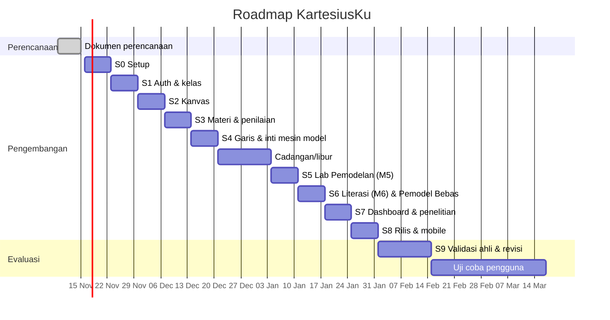

# 11 — Roadmap & Rencana Sprint

| Atribut | Keterangan |
|---------|------------|
| Versi | 1.1 |
| Tanggal | 10 November 2026 |
| Penyusun | Inayatul Sholihah |
| Metode | Agile (Scrum ringan), sprint 1 minggu, satu pengembang |

> Tanggal di bawah adalah perkiraan, dimulai Senin 16 November 2026. Sesuaikan dengan kalender akademik dan jadwal bimbingan.
> Versi 1.1 menambah pekerjaan literasi & pemodelan (mesin model, Lab Pemodelan, stimulus, Pemodel Bebas, profil literasi), sehingga jadwal bertambah ±1 minggu.

## Daftar Isi
1. [Milestone](#1-milestone)
2. [Rencana Sprint](#2-rencana-sprint)
3. [Timeline](#3-timeline)
4. [Ritme Kerja](#4-ritme-kerja)
5. [Riwayat Revisi](#5-riwayat-revisi)

---

## 1. Milestone

| ID | Milestone | Target | Keluaran |
|----|-----------|--------|----------|
| MS-0 | Perencanaan selesai | 15 Nov 2026 | Dokumen `docs/` disetujui pembimbing |
| MS-1 | Fondasi teknis | 29 Nov 2026 | Repo, CI, auth, kelas berjalan |
| MS-2 | Kanvas, materi inti & inti mesin model | 20 Des 2026 | M1–M4 dapat dipelajari; mesin model MP-1 s.d. MP-5 lulus fixture |
| MS-3 | Pemodelan & literasi | 17 Jan 2027 | Lab Pemodelan (M5), stimulus & M6, Pemodel Bebas, profil literasi |
| MS-4 | MVP lengkap & siap validasi | 31 Jan 2027 | Dashboard guru, instrumen penelitian, APK, PWA terdeploy, bug kritis nol |
| MS-5 | Validasi ahli & revisi | 14 Feb 2027 | Revisi berdasarkan saran ahli (materi, media, literasi) |
| MS-6 | Uji coba & laporan | Feb–Mar 2027 | Data uji coba, analisis (beban kognitif, literasi, kegunaan), laporan |

## 2. Rencana Sprint

| Sprint | Periode | Fokus | Item Utama | Fitur |
|--------|---------|-------|-----------|-------|
| S0 | 16–22 Nov | Setup | Monorepo `frontend/` + `backend/` + `shared/`, ESLint/Prettier/Ruff, GitHub Actions CI, Tailwind + design tokens, koneksi DB, Alembic awal, `/health` | — |
| S1 | 23–29 Nov | Auth & kelas | Register/login siswa & guru, JWT + refresh, guard rute per peran, buat/gabung kelas | F-10, F-11 |
| S2 | 30 Nov–6 Des | Kanvas | `CartesianCanvas` (grid, sumbu, titik, drag, snap, tombol panah, label), unit test `lib/math`, mode eksplorasi | F-02, F-03 |
| S3 | 7–13 Des | Materi & penilaian | Seed modul/soal, `LessonPlayer`, `POST /attempts`, `grading.py` (plot/read/quadrant/MC), M1 & M2 | F-06, F-07 |
| S4 | 14–20 Des | Titik relatif, garis & inti mesin model | Panah langkah, hint bertingkat, `draw_line`, miskonsepsi MK-1 s.d. MK-6, M3 & M4. **Mesin model** (registry, MP-1 s.d. MP-5) dalam TS & Python + fixture bersama di CI | F-04, F-05, F-09, F-27 |
| — | 21 Des–3 Jan | Cadangan / libur | Perbaikan bug, utang teknis, penulisan soal & stimulus | — |
| S5 | 4–10 Jan | Lab Pemodelan (M5) | `ModelingStepper`, `TokenText`, `ModelCard`, `ModelBuilder`, `SolutionPlayer`, endpoint langkah, skor per langkah, *fading*, M5, tutorial awal & bantuan | F-01, F-08, F-18, F-22, F-26 |
| S6 | 11–17 Jan | Literasi (M6) & Pemodel Bebas | MP-6 s.d. MP-8 + `composite`, stimulus & butir literasi, M6, Pemodel Bebas + simpan model, profil literasi siswa, progres & bintang | F-12, F-23, F-24, F-25 |
| S7 | 18–24 Jan | Dashboard guru & penelitian | Overview, tabel siswa, analisis soal, detail siswa (termasuk model siswa), tab Literasi, ekspor CSV, Paas, SUS, pretest/posttest + tes literasi, ekspor penelitian | F-13–F-16, F-25 |
| S8 | 25–31 Jan | Rilis & mobile | PWA, offline ringan (termasuk mesin model offline), build APK, uji perangkat, E2E Playwright, deploy produksi | F-17 |
| S9 | 1–14 Feb | Validasi ahli | Kirim ke ahli materi, media, literasi; kumpulkan angket; revisi konten & UI | — |
| S10+ | Feb–Mar | Uji coba | One-to-one, kelompok kecil, uji lapangan; analisis data | — |

### Prioritas jika waktu tidak cukup
Tunda berurutan: F-19 Narasi Audio → F-20 Lencana → F-17 Offline → F-23 Pemodel Bebas → F-25 tren mingguan (tetap tampilkan profil sederhana). **Jangan menunda** Lab Pemodelan (F-22), Stimulus (F-24), dan Mesin Model (F-27), karena ketiganya inti tujuan literasi.

### Definisi Selesai per Sprint
Mengikuti [CLAUDE.md §8](../CLAUDE.md#8-definition-of-done). Setiap akhir sprint: demo singkat (rekam layar) untuk bimbingan.

## 3. Timeline

## 4. Ritme Kerja

- **Senin:** perencanaan sprint (pilih item dari backlog, perkirakan).
- **Harian:** catatan progres singkat di `docs/log/` atau issue GitHub.
- **Jumat/Minggu:** review & demo, retrospektif singkat (apa yang berhasil, apa yang diperbaiki).
- Backlog dikelola di GitHub Projects dengan label: `feat`, `bug`, `content`, `research`, `literacy`, `model-engine`, `prio:M/S/C`.

## 5. Riwayat Revisi

| Versi | Tanggal | Perubahan |
|-------|---------|-----------|
| 1.0 | 10-11-2026 | Draf awal |
| 1.1 | 10-11-2026 | Menambah sprint literasi & pemodelan, menggeser milestone MS-3 s.d. MS-5 |
