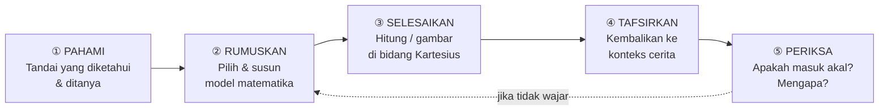
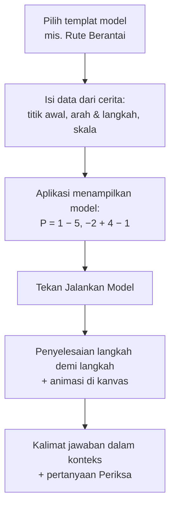

# 13 — Literasi Matematika & Pemodelan Soal Cerita

| Atribut | Keterangan |
|---------|------------|
| Versi | 1.0 |
| Tanggal | 10 November 2026 |
| Penyusun | Inayatul Sholihah |
| Status | Draf untuk ditinjau |
| Terkait | [02-PRD.md](02-PRD.md), [04-desain-pembelajaran.md](04-desain-pembelajaran.md), [05-bank-soal-spesifikasi.md](05-bank-soal-spesifikasi.md) |

## Daftar Isi
1. [Latar Belakang & Tujuan](#1-latar-belakang--tujuan)
2. [Kerangka Literasi Matematika](#2-kerangka-literasi-matematika)
3. [Siklus Pemodelan di Aplikasi](#3-siklus-pemodelan-di-aplikasi)
4. [Pustaka Model Matematika](#4-pustaka-model-matematika)
5. [Mesin Model (Model Engine)](#5-mesin-model-model-engine)
6. [Fitur](#6-fitur)
7. [Stimulus Literasi (Gaya AKM)](#7-stimulus-literasi-gaya-akm)
8. [Contoh Pemodelan Lengkap](#8-contoh-pemodelan-lengkap)
9. [Penilaian & Profil Literasi](#9-penilaian--profil-literasi)
10. [Miskonsepsi Tambahan](#10-miskonsepsi-tambahan)
11. [Kaitan dengan Beban Kognitif](#11-kaitan-dengan-beban-kognitif)
12. [Batasan](#12-batasan)
13. [Riwayat Revisi](#13-riwayat-revisi)

---

## 1. Latar Belakang & Tujuan

Selain mengatasi temuan wawancara (W-1 s.d. W-4), aplikasi ditujukan untuk **menumbuhkembangkan literasi matematika** siswa. Kesulitan utama siswa justru pada soal cerita (W-3), yaitu titik tempat literasi matematika diuji: siswa harus mengubah situasi nyata menjadi model matematika, menyelesaikannya, lalu menafsirkan hasilnya kembali ke situasi tersebut.

**Tujuan:**
1. Siswa mampu **merumuskan** soal cerita kontekstual menjadi model matematika pada bidang Kartesius.
2. Siswa mampu **menerapkan** konsep dan prosedur untuk menyelesaikan model.
3. Siswa mampu **menafsirkan dan mengevaluasi** hasil penyelesaian dalam konteks soal.
4. Aplikasi mampu **menyelesaikan model** yang disusun siswa secara otomatis dan menampilkan langkah penyelesaiannya, sehingga siswa dapat memeriksa pekerjaannya sendiri.

**Keputusan desain:** Pemodelan dilakukan secara **terpandu dan berbasis templat model**, **tanpa AI**. Alasannya: hasil selalu benar dan dapat diuji, dapat bekerja offline, tanpa biaya API, dan tidak ada data anak yang dikirim ke layanan luar.

## 2. Kerangka Literasi Matematika

### 2.1 Definisi
Mengacu pada **PISA 2022 Mathematics Framework (OECD)**: literasi matematika adalah kemampuan individu untuk bernalar secara matematis serta merumuskan, menerapkan, dan menafsirkan matematika untuk memecahkan masalah dalam berbagai konteks dunia nyata.

Di Indonesia, kemampuan ini diukur melalui **AKM Numerasi** (Asesmen Nasional), yang memuat:
- **Konten:** Bilangan, Aljabar, Geometri & Pengukuran, Data & Ketidakpastian. Koordinat Kartesius termasuk Geometri & Pengukuran dan Aljabar.
- **Proses/level kognitif:** Pemahaman (*knowing*), Penerapan (*applying*), Penalaran (*reasoning*).
- **Konteks:** Personal, Sosial Budaya, Saintifik.

> Rumusan di atas perlu dicocokkan dengan dokumen resmi terbaru (OECD PISA 2022 Framework dan Framework Asesmen Nasional Kemendikbudristek) sebelum dikutip dalam laporan.

### 2.2 Pemetaan Proses Literasi ke Aplikasi

| Proses PISA | Level AKM | Indikator pada Materi Kartesius | Langkah Aplikasi |
|-------------|-----------|----------------------------------|------------------|
| **Merumuskan** (*formulate*) | Penerapan/Penalaran | Mengidentifikasi informasi penting; menentukan titik acuan, arah, satuan, dan skala; memilih model yang sesuai | ① Pahami, ② Rumuskan |
| **Menerapkan** (*employ*) | Pemahaman/Penerapan | Menghitung koordinat, jarak, luas, keliling; menggambar titik dan garis | ③ Selesaikan |
| **Menafsirkan & mengevaluasi** (*interpret/evaluate*) | Penalaran | Mengembalikan hasil ke konteks (arah mata angin, meter); menilai kewajaran; memilih alasan | ④ Tafsirkan, ⑤ Periksa |
| **Penalaran matematis** (inti) | Penalaran | Memberi alasan, membandingkan rute, menarik kesimpulan | Pertanyaan "Mengapa?" di langkah ⑤ |

### 2.3 Konteks Soal

| Konteks | Contoh Situasi |
|---------|----------------|
| Personal | Rute rumah–sekolah, tempat duduk di kelas, permainan papan |
| Sosial budaya | Denah desa/pasar, rute kurir, tata letak lampu taman, pembagian kavling kebun |
| Saintifik | Peta dengan skala, posisi pengamatan, pola penanaman |

Konteks dipilih dekat dengan kehidupan siswa SMP di Indonesia dan beragam (desa–kota, nama dari berbagai daerah).

## 3. Siklus Pemodelan di Aplikasi

Siklus pemodelan Blum & Leiß (2007) disederhanakan menjadi **5 langkah** yang selalu tampil dengan urutan dan ikon yang sama (*stepper*). Langkah tetap dan konsisten ini mengurangi beban kognitif ekstrinsik.



| Langkah | Yang Dilakukan Siswa | Bentuk Interaksi | Bantuan |
|---------|----------------------|------------------|---------|
| ① Pahami | Mengetuk kata/angka penting pada cerita, lalu memasukkannya ke kotak **Diketahui** atau **Ditanya** | Ketuk token teks; seret ke kotak | Highlight otomatis (level 1) |
| ② Rumuskan | Memilih **jenis model** dari kartu model, lalu mengisi parameternya (titik awal, perpindahan, skala). Model tampil dalam notasi matematika | Kartu pilihan + isian kosong + plot titik acuan | Kartu "Model ini dipakai jika…" |
| ③ Selesaikan | Menghitung hasil (isian) atau menaruh jawaban di kanvas, lalu menekan **Jalankan Model** untuk melihat langkah penyelesaian dari mesin | Isian + kanvas + animasi | Langkah penyelesaian bertahap |
| ④ Tafsirkan | Memilih atau menyusun kalimat jawaban dalam konteks (arah mata angin, satuan nyata) | Pilihan kalimat / isian satuan | Daftar satuan & arah |
| ⑤ Periksa | Menjawab pertanyaan kewajaran (mis. "Mengapa jarak tempuh lebih besar dari jarak lurus?") | Pilihan alasan | Contoh alasan pada level 1 |

### 3.1 Pemudaran Bantuan (*Fading*)

| Level | ① Pahami | ② Rumuskan | ③ Selesaikan | ④–⑤ |
|-------|----------|------------|--------------|-----|
| 1 — Terbimbing | Informasi sudah disorot dan terisi | Jenis model dipilihkan; siswa mengisi 1–2 parameter | Mesin menampilkan langkah setelah siswa menjawab | Pilihan ganda 3 opsi |
| 2 — Semi-terbimbing | Siswa mengetuk informasi sendiri | Siswa memilih model dari 3 kartu | Siswa menghitung sendiri, lalu memeriksa dengan mesin | Pilihan ganda 4 opsi |
| 3 — Mandiri | Siswa mengetuk informasi tanpa sorotan | Siswa memilih dari semua kartu model; bisa menggabungkan 2 model | "Jalankan Model" hanya tersedia sebagai hint | Menyusun kalimat dari potongan kata |

## 4. Pustaka Model Matematika

Setiap soal cerita dalam cakupan aplikasi dapat dinyatakan dengan satu model atau gabungan beberapa model berikut. **Konvensi arah:** kanan/timur = +x, kiri/barat = −x, atas/utara = +y, bawah/selatan = −y.

| Kode | Nama Model | Notasi Model | Pertanyaan yang Dijawab | Contoh Konteks |
|------|------------|--------------|-------------------------|----------------|
| **MP-1** | Titik dari titik acuan (translasi) | B = (x_A + a, y_A + b) | Di mana letak suatu tempat jika diketahui posisinya dari tempat lain? | Sekolah 5 ke timur, 3 ke utara dari rumah |
| **MP-2** | Rute berantai | P_akhir = (x₀ + Σa_i, y₀ + Σb_i) | Di mana posisi akhir setelah beberapa perpindahan? | Rute kurir, langkah bidak |
| **MP-3** | Jarak sejajar sumbu & jarak tempuh | d = \|x₂ − x₁\| atau \|y₂ − y₁\|; tempuh = Σ(\|a_i\| + \|b_i\|) | Berapa jauh jarak/jarak tempuh di jalan berpetak? | Jarak dua rumah di satu jalan, total rute |
| **MP-4** | Posisi relatif | (x_B − x_A, y_B − y_A) | B berada di mana jika dilihat dari A? | Posisi pasar dari balai desa |
| **MP-5** | Garis sejajar/tegak lurus sumbu | y = k (sejajar sumbu X), x = k (sejajar sumbu Y) | Titik mana yang dilalui jalan/pagar? Titik terdekat di jalan? | Jalan lurus, pagar, rel |
| **MP-6** | Bangun datar pada bidang | p = \|Δx\|, l = \|Δy\|; L = p × l; K = 2(p + l); L_segitiga siku = ½ × a × t | Titik sudut yang hilang, luas, keliling | Kebun, lapangan, kavling |
| **MP-7** | Skala | Jarak sebenarnya = n satuan × s; Luas sebenarnya = n satuan² × s² | Berapa meter/kilometer sebenarnya? | Peta, denah |
| **MP-8** | Pola titik (translasi berulang) | P_n = (x₁ + (n − 1)a, y₁ + (n − 1)b) | Di mana titik ke-n? Apakah titik ke-n masih di dalam batas? | Lampu taman, pohon, kursi berjajar |

> Bangun datar pada MP-6 dibatasi pada bangun dengan sisi **sejajar sumbu** (persegi, persegi panjang, segitiga siku-siku), sesuai jenjang dan cakupan Koordinat Kartesius kelas VIII.

### 4.1 Representasi Model (JSON)

Model disimpan sebagai struktur data yang dapat diperiksa dan dijalankan oleh mesin:

```json
{
  "kind": "route_chain",
  "start": { "label": "Gudang", "x": 1, "y": -2 },
  "moves": [
    { "dir": "utara", "n": 4 },
    { "dir": "barat", "n": 5 },
    { "dir": "selatan", "n": 1 }
  ],
  "scale": { "per_unit": 100, "unit": "m" },
  "ask": ["final_position", "travel_distance"]
}
```

Jenis `kind` yang didukung: `translate` (MP-1), `route_chain` (MP-2), `axis_distance` (MP-3), `relative_position` (MP-4), `axis_line` (MP-5), `rect_shape` / `right_triangle` (MP-6), `scale` (MP-7, dapat melekat pada model lain), `point_pattern` (MP-8). Satu soal dapat memakai `composite` yang berisi beberapa model.

## 5. Mesin Model (Model Engine)

Mesin model adalah kumpulan **fungsi murni** yang **menyelesaikan model** dan **menghasilkan langkah penyelesaian** dalam bahasa Indonesia.

```
solveModel(model)          → { result, steps[], canvas }
checkStep(stepKey, input)  → { correct, misconception?, feedback }
describeModel(model)       → notasi matematika yang mudah dibaca, mis. "B = (−2 + 5, 1 + 3)"
```

- **Lokasi kode:**
  - Frontend: `frontend/src/lib/math/models/` (TypeScript), dipakai untuk animasi, mode offline, dan Pemodel Bebas.
  - Backend: `backend/app/services/modeling.py` (Python), yang menjadi **sumber penilaian resmi**.
- **Kesetaraan FE–BE:** kedua implementasi diuji dengan berkas uji bersama `shared/model-fixtures/*.json` (input model → hasil & langkah yang diharapkan) agar hasilnya selalu identik.
- **Keluaran `steps[]`:** tiap langkah memuat teks, ekspresi, dan instruksi kanvas, misalnya:
  ```json
  { "text": "Mulai dari gudang.", "expr": "(1, −2)", "canvas": { "highlight_point": [1, -2] } }
  { "text": "Ke utara 4 satuan: y bertambah 4.", "expr": "(1, −2 + 4) = (1, 2)", "canvas": { "arrow": [[1,-2],[1,2]] } }
  ```
- **Pemeriksaan kesetaraan model:** urutan perpindahan pada `route_chain` boleh berbeda selama jumlahnya sama. Arah boleh ditulis sebagai kata (timur) atau tanda (+x).
- **Validasi:** mesin menolak model yang tidak valid (mis. titik di luar rentang kanvas atau skala ≤ 0) dengan pesan ramah.

## 6. Fitur

| ID | Fitur | Deskripsi | Prioritas |
|----|-------|-----------|-----------|
| **F-22** | **Lab Pemodelan Terpandu** | Soal cerita dikerjakan melalui 5 langkah siklus pemodelan dengan pemeriksaan per langkah dan *fading* | Must |
| **F-23** | **Pemodel Bebas** | Siswa atau guru memilih templat model (MP-1 s.d. MP-8), mengisi data dari soal cerita apa pun yang sesuai (mis. dari buku paket) lewat formulir, lalu aplikasi menampilkan model, gambar di kanvas, dan **penyelesaian langkah demi langkah** | Should |
| **F-24** | **Stimulus Literasi** | Satu stimulus (denah, peta, tabel, cerita) dengan 3–5 pertanyaan bertingkat (pemahaman → penerapan → penalaran), bergaya AKM | Must |
| **F-25** | **Profil Literasi** | Grafik kemampuan siswa per proses (Merumuskan, Menerapkan, Menafsirkan) dan per level kognitif; tampil untuk siswa (sederhana) dan guru (rinci) | Should |
| **F-26** | **Kartu Model** | Ringkasan tiap model: kapan dipakai, notasi, contoh singkat; dapat dibuka kapan saja sebagai referensi | Must |

### 6.1 Alur Pemodel Bebas (F-23)



Formulir memakai kosakata cerita (pilihan arah "utara/selatan/timur/barat" atau "kanan/kiri/atas/bawah"), bukan notasi formal, sehingga siswa belajar menerjemahkan bahasa sehari-hari ke model.

## 7. Stimulus Literasi (Gaya AKM)

Satu stimulus menampung beberapa butir soal yang memakai data yang sama. Siswa hanya perlu memahami konteks sekali, sehingga beban kognitif lebih rendah dibanding banyak cerita berbeda.

**Contoh stimulus — "Denah Desa Sukamaju"** (1 satuan = 100 m)

| Tempat | Koordinat |
|--------|-----------|
| Balai desa | (0, 0) |
| Masjid | (−3, 4) |
| Pasar | (5, 4) |
| Puskesmas | (5, −2) |
| Sekolah | (−3, −2) |

| No | Pertanyaan | Proses | Level | Model | Kunci |
|----|-----------|--------|-------|-------|-------|
| 1 | Di kuadran berapa letak masjid? | Menerapkan | Pemahaman | — | Kuadran II |
| 2 | Pasar berada di mana jika dilihat dari masjid? | Merumuskan | Penerapan | MP-4 | 8 satuan ke timur (y sama) |
| 3 | Berapa meter jarak sebenarnya dari masjid ke pasar? | Menerapkan | Penerapan | MP-3 + MP-7 | 8 × 100 = 800 m |
| 4 | Masjid, pasar, puskesmas, dan sekolah membentuk bangun apa? Berapa luas sebenarnya? | Merumuskan + Menerapkan | Penalaran | MP-6 + MP-7 | Persegi panjang 8 × 6 = 48 satuan²; 48 × 100² = 480.000 m² |
| 5 | Dina berkata, "Dari sekolah ke pasar lewat jalan berpetak paling dekat 8 satuan." Benarkah? Mengapa? | Menafsirkan | Penalaran | MP-3 | Tidak benar. Jarak berpetak terpendek = 8 + 6 = 14 satuan |

## 8. Contoh Pemodelan Lengkap

### Contoh A — Level 1, MP-1 (personal)
> Rumah Sinta di **(−2, 1)**. Sekolah berada **5 satuan ke timur** dan **3 satuan ke utara** dari rumah Sinta. Di mana letak sekolah?

| Langkah | Isi |
|---------|-----|
| ① Pahami | Diketahui: rumah (−2, 1); 5 ke timur; 3 ke utara. Ditanya: koordinat sekolah. |
| ② Rumuskan | Model MP-1: S = (−2 + 5, 1 + 3) |
| ③ Selesaikan | S = (3, 4) |
| ④ Tafsirkan | Sekolah Sinta berada di titik (3, 4). |
| ⑤ Periksa | Timur → x bertambah ✔, utara → y bertambah ✔. Sekolah berada di kanan atas rumah ✔ |

### Contoh B — Level 2, MP-2 + MP-3 + MP-7 (sosial)
> Kurir berangkat dari gudang di **(1, −2)**. Ia berjalan **4 satuan ke utara**, lalu **5 satuan ke barat**, lalu **1 satuan ke selatan**. Satu satuan = **100 m**. Di mana posisi akhir kurir dan berapa jarak tempuhnya?

| Langkah | Isi |
|---------|-----|
| ② Rumuskan | P = (1 − 5, −2 + 4 − 1); Tempuh = (4 + 5 + 1) × 100 m |
| ③ Selesaikan | P = (−4, 1); tempuh = 10 satuan = 1.000 m |
| ④ Tafsirkan | Kurir berada di (−4, 1) dan telah menempuh 1 km. |
| ⑤ Periksa | Jarak berpetak terpendek dari gudang ke posisi akhir hanya 5 + 3 = 8 satuan. Jarak tempuh 10 satuan lebih besar karena kurir sempat ke selatan setelah ke utara. Ini wajar ✔ (bandingkan MK-9) |

### Contoh C — Level 2, MP-6 + MP-7 (sosial budaya)
> Kebun Pak Hasan berbentuk persegi panjang. Tiga titik sudutnya **A(−3, −1)**, **B(5, −1)**, dan **C(5, 3)**. Satu satuan = **2 m**. Tentukan titik D dan luas kebun sebenarnya.

| Langkah | Isi |
|---------|-----|
| ② Rumuskan | D = (x_A, y_C); p = \|5 − (−3)\|; l = \|3 − (−1)\|; L = p × l × 2² |
| ③ Selesaikan | D = (−3, 3); p = 8 satuan = 16 m; l = 4 satuan = 8 m; L = 16 × 8 = **128 m²** |
| ④ Tafsirkan | Luas kebun Pak Hasan 128 m². |
| ⑤ Periksa | Jika 32 satuan² hanya dikali 2, hasilnya 64 m², dan itu **keliru** karena skala luas = 2 × 2 (miskonsepsi MK-7). |

### Contoh D — Level 3, MP-5 + MP-3 (sosial)
> Jalan desa lurus melewati pos ronda **(−4, 2)** dan masjid **(6, 2)**. Rumah Pak Budi di **(1, −3)**. Ia ingin menuju jalan itu lewat jalur terpendek. Di titik mana ia tiba di jalan, dan berapa satuan jaraknya?

| Langkah | Isi |
|---------|-----|
| ② Rumuskan | Jalan: y = 2 (sejajar sumbu X). Titik terdekat: (1, 2). d = \|2 − (−3)\| |
| ③ Selesaikan | Tiba di (1, 2); d = 5 satuan |
| ④ Tafsirkan | Pak Budi berjalan lurus ke utara 5 satuan dan tiba di (1, 2). |
| ⑤ Periksa | Jalur tegak lurus terhadap jalan adalah yang terpendek ✔ |

### Contoh E — Level 3, MP-8 (penalaran)
> Lampu taman pertama dipasang di **(−6, −1)**. Setiap lampu berikutnya dipasang **3 satuan ke kanan** dan **1 satuan ke atas** dari lampu sebelumnya. Di mana lampu ke-5? Jika batas kanan taman adalah x = 8, apakah lampu ke-6 masih di dalam taman?

| Langkah | Isi |
|---------|-----|
| ② Rumuskan | P_n = (−6 + (n − 1) × 3, −1 + (n − 1) × 1) |
| ③ Selesaikan | P₅ = (−6 + 12, −1 + 4) = (6, 3); P₆ = (9, 4) |
| ④ Tafsirkan | Lampu ke-5 di (6, 3). Lampu ke-6 di x = 9, jadi melewati batas x = 8. |
| ⑤ Periksa | Lampu ke-6 **tidak** di dalam taman. Kesalahan umum: memakai n × 3 (bukan (n − 1) × 3) (MK-10). |

## 9. Penilaian & Profil Literasi

### 9.1 Skor per Langkah (Lab Pemodelan)

| Langkah | Bobot | Proses Literasi |
|---------|-------|-----------------|
| ① Pahami | 15 | Merumuskan |
| ② Rumuskan | 30 | Merumuskan |
| ③ Selesaikan | 25 | Menerapkan |
| ④ Tafsirkan | 15 | Menafsirkan |
| ⑤ Periksa | 15 | Menafsirkan/Penalaran |

Pengurangan skor karena hint berlaku **per langkah**: hint level 1/2/3 menurunkan skor maksimal langkah itu menjadi 90%/75%/60%. Langkah yang sudah benar dikunci agar siswa tidak perlu mengulang dari awal.

### 9.2 Profil Literasi (F-25)
- Skor tiap proses = rata-rata persentase skor langkah yang termasuk proses tersebut, dari seluruh soal pemodelan dan stimulus.
- Ditampilkan sebagai **diagram batang 3 proses** dan **tren mingguan**.
- Kategori: ≥ 80 Mahir, 60–79 Cakap, 40–59 Dasar, < 40 Perlu Intervensi (mengikuti semangat 4 level AKM; label akhir disesuaikan dengan acuan resmi).
- Guru melihat profil kelas dan siswa yang lemah pada proses tertentu, misalnya "12 siswa lemah pada Merumuskan".

### 9.3 Pengukuran Pertumbuhan Literasi
- **Tes literasi awal dan akhir:** 2 stimulus × 4–5 butir, setara (paralel), berisi butir pilihan ganda kompleks, isian, dan penalaran (alasan dipilih dari opsi agar dapat dinilai otomatis; 1 butir uraian opsional dinilai guru).
- Analisis **N-gain literasi** dan perubahan profil per proses.
- Validasi instrumen oleh ahli materi; uji reliabilitas (mis. Alpha Cronbach) bila jumlah responden memadai.

## 10. Miskonsepsi Tambahan

| Kode | Miskonsepsi | Deteksi | Umpan Balik |
|------|-------------|---------|-------------|
| MK-7 | Skala luas hanya dikali satu kali | Luas = n × s | "Luas memakai skala dua kali (panjang dan lebar): kalikan dengan s × s." |
| MK-8 | Arah mata angin keliru (barat dianggap +x) | Tanda dx/dy terbalik pada arah tertentu | "Barat = kiri, jadi nilai x berkurang." |
| MK-9 | Jarak tempuh disamakan dengan jarak posisi awal–akhir | Jawaban = jarak perpindahan | "Jarak tempuh menjumlahkan semua langkah yang dijalani." |
| MK-10 | Pola titik memakai n, bukan (n − 1) | Hasil bergeser satu suku | "Lampu pertama belum bergeser. Lampu ke-n bergeser (n − 1) kali." |
| MK-11 | Jarak dihitung dengan menjumlah koordinat, bukan selisih | d = \|x₁\| + \|x₂\| pada sisi yang sama | "Jarak = selisih koordinat: \|x₂ − x₁\|." |
| MK-12 | Hasil tidak dikembalikan ke konteks (satuan hilang) | Jawaban tanpa satuan nyata | "Jawabanmu masih dalam satuan grid. Ubah ke meter memakai skala." |

## 11. Kaitan dengan Beban Kognitif

| Risiko | Penanganan |
|--------|-----------|
| Siklus 5 langkah menambah beban ekstrinsik | Stepper tetap dan konsisten; hanya satu langkah aktif yang ditampilkan |
| Notasi model terasa abstrak | Model ditampilkan berdampingan dengan kanvas dan kata dari cerita (*spatial contiguity*) |
| Terlalu banyak informasi dalam stimulus | Data stimulus ditampilkan sebagai tabel/denah ringkas, dapat disematkan (*pin*) saat menjawab |
| Siswa pemula kewalahan | *Fading* 3 level; level 1 wajib sebelum level 2 terbuka |
| Mesin model membuat siswa pasif | "Jalankan Model" baru tersedia **setelah** siswa mencoba (level 1–2) atau sebagai hint (level 3) |

## 12. Batasan

- Aplikasi **tidak** membaca teks soal cerita bebas secara otomatis (tidak memakai NLP/AI). Pemodelan soal baru dilakukan lewat **Pemodel Bebas** (formulir templat) atau oleh admin melalui bank soal.
- Cakupan model terbatas pada **MP-1 s.d. MP-8** (Koordinat Kartesius yang diperluas). Persamaan garis lurus y = mx + c, gradien, dan jarak Euclid (Pythagoras) tidak termasuk versi 1.0, tetapi struktur `kind` model memungkinkan penambahan pada versi berikutnya.

## 13. Riwayat Revisi

| Versi | Tanggal | Penyusun | Perubahan |
|-------|---------|----------|-----------|
| 1.0 | 10-11-2026 | Inayatul Sholihah | Draf awal: literasi & pemodelan |
